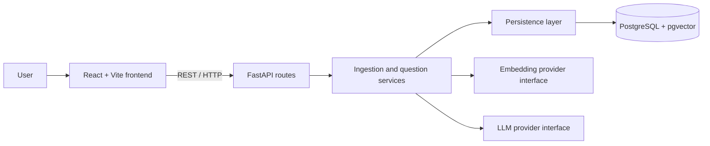

# DevDocs AI

A technical documentation assistant that retrieves relevant passages from uploaded
documents and uses a language model to produce answers with source citations.

**Status:** Milestone 6 — React frontend complete. The browser workspace supports
upload, indexing, document browsing, independent questions, answers, and expandable
source citations. Retrieval tuning and quality evaluation remain later milestones.
Answer generation now supports OpenAI `gpt-5.4-mini` alongside local Ollama.
Citation validation remains strict for both providers; invalid references are
shown as useful errors rather than accepted as grounded responses.
This project is built one milestone at a time, with explanations and verification
before continuing.

## Problem and intended outcome

Developers need to find answers in technical documentation without losing the
ability to check the original source. DevDocs AI will make that process easier
by combining semantic retrieval with source-grounded generation.

The project also serves as an engineering learning portfolio: design decisions,
tests, evaluation results, and limitations will be documented alongside code.

## MVP requirements

- Upload UTF-8 `.txt`, `.md`, and text-based PDF documents.
- Validate file type, size, and extracted content; return useful errors for
  unsupported, empty, corrupt, or oversized files. Initial upload limit: 10 MiB.
- List uploaded documents and their ingestion status.
- Extract text, divide it into chunks, and store document and chunk metadata.
- Generate and persist embeddings for chunks.
- Accept one question per request and retrieve relevant chunks.
- Generate an answer using retrieved evidence, with citations identifying the
  document and chunk; retain PDF page references where extraction permits.
- Return the cited source excerpts separately from the generated answer so users
  can verify the claims.
- Explain when the available evidence does not support an answer.
- Provide a React interface with upload, document list, questions, answers,
  citations, and clear loading/error states.

The first usable RAG backend arrives in Milestone 5; the browser MVP arrives in
Milestone 6. Evidence handling is strengthened in Milestone 7 and measured in
Milestone 8. Portfolio readiness includes the later engineering and polish work.

### Initial scope boundaries

One user working with one shared document collection in a local development
environment. Questions are independent; conversation memory is outside the MVP.
There is no authentication or tenant isolation, so the initial system is not
intended for public deployment with private documents.

OCR for scanned PDFs, website crawling, document editing/deletion, streaming,
hybrid search, reranking, and distributed ingestion workers are outside the MVP.
Tool calling is reserved for Milestone 10. A simple RAG system comes first.

### Acceptance criteria

1. A supported document uploads, becomes searchable, and appears in the list.
2. A question whose answer exists in that document returns a relevant answer and
   citations that resolve to stored chunks and source excerpts.
3. A question without supporting evidence produces an explicit insufficient-
   evidence response; this behaviour is evaluated, not assumed.
4. Invalid uploads and provider failures return understandable errors without
   exposing credentials or internal stack traces.
5. Meaningful automated tests cover ingestion, retrieval, and answer/citation
   handling as those features are introduced.
6. Documented setup and CI checks make the finished project reproducible.

## Planned architecture

Use a modular monolith: one backend process with clear internal responsibilities.
This keeps deployment simple while allowing components to be tested separately.



### Two flows

**Ingestion:** upload → validate → extract text → chunk → embed → persist.

**Question answering:** question → embed → retrieve chunks → construct context
→ prompt LLM → validate citation references → return answer and sources.

Document status will distinguish processing, ready, and failed documents. Only
ready documents should contribute retrieval results. Ingestion starts with a
bounded request-based flow; a durable job queue is a later option if processing
times require it. Async HTTP code alone does not make CPU-heavy work nonblocking.

### Responsibilities and decisions

| Area | Responsibility and reason |
| --- | --- |
| API | Validate request/response shapes and map failures to HTTP responses. Keep orchestration out of route handlers. |
| Services | Coordinate ingestion and questions. Keep business rules testable without a browser. |
| Persistence | Store and query documents, chunks, and vectors. Keep database details out of provider code. |
| AI | Separate embedding and generation providers. Replacing an LLM should not require rewriting upload or database logic. |
| PostgreSQL + pgvector | Keep relational metadata and searchable vectors in one database, reducing infrastructure for this project. |
| React + Vite | Use the familiar frontend stack for a focused upload and question interface. |
| Configuration | Read environment settings in the backend; never send provider secrets to the browser. |
| Testing | Use deterministic provider substitutes for normal automated tests; run live-provider quality evaluations separately. |

Embeddings represent text as numerical vectors. Semantic search compares those
vectors to find passages related in meaning to a question. The LLM then generates
text using the retrieved passages. Retrieval and generation are separate steps
with separate failure modes.

Switching embedding models can change vector dimensions and the meaning of the
vector coordinates. Stored chunks must be re-embedded when the embedding model
changes; provider replacement is not automatically a configuration-only change.
Record model identity and chunking settings with ingestion data when implemented.

### Grounding and trust

Retrieved text is evidence, not executable instructions. Prompts will separate
the user's question from source passages and tell the model to answer only from
the supplied evidence. Citations will use stable chunk identifiers, and the
backend will check that references belong to the retrieved set. This checks
reference validity; evaluating whether a cited passage actually supports a
claim is a separate quality task. RAG reduces unsupported answers but does not
eliminate them.

### Database model — implemented in Milestone 2

- **Document:** UUID, filename, media type, size in bytes, processing/ready/failed
  status, optional safe error message, and timezone-aware creation/update times.
- **Chunk:** UUID, document UUID, zero-based position, text, optional one-based PDF
  page reference, and creation time.

One document has many chunks. A foreign key prevents orphan chunks; a unique
constraint prevents two chunks occupying the same position in a document. Its
index also supports querying chunks by document. Database check constraints
reject invalid sizes, statuses, positions, empty text/filenames, and page numbers.
Deleting a document cascades to its chunks; no deletion API is implemented yet.
UUIDs provide stable source identifiers independent of filename or text changes.
`updated_at` is refreshed by SQLAlchemy updates, not a database trigger; direct SQL
writers must set it themselves.

Each chunk now has a nullable `embedding` vector and `embedding_model` identifier.
Migration `0002` preserves existing text with null embedding fields; the explicit
indexing endpoint fills them. A database constraint requires both fields to be
present or both absent. Chunking metadata and approximate indexes remain future
work. Source text and identifiers are unchanged by re-indexing.

## Directory structure

Current layout:

```text
DevDocs AI/
├── README.md
├── .gitignore
├── .env.example
├── compose.yaml             # local PostgreSQL + pgvector service
├── backend/
│   ├── pyproject.toml       # dependencies and test/lint configuration
│   ├── uv.lock              # exact resolved dependency versions
│   ├── alembic.ini          # migration configuration
│   ├── migrations/          # env.py, revision template, and versioned schema
│   ├── app/
│   │   ├── __init__.py
│   │   ├── main.py          # create_app factory
│   │   ├── api/
│   │   │   ├── __init__.py
│   │   │   ├── health.py    # liveness/readiness routes
│   │   │   ├── documents.py # upload and inspection routes
│   │   │   ├── document_schemas.py
│   │   │   ├── search.py    # index and semantic retrieval routes
│   │   │   └── questions.py # RAG answer and citation contracts
│   │   ├── ai/
│   │   │   ├── __init__.py
│   │   │   ├── embeddings.py # provider contract and vector validation
│   │   │   ├── ollama.py     # local embedding and generation adapters
│   │   │   ├── openai.py     # external Responses API generation adapter
│   │   │   └── llm.py        # generation contract and structured output
│   │   ├── core/
│   │   │   ├── __init__.py
│   │   │   └── config.py    # typed environment settings
│   │   ├── services/
│   │   │   ├── __init__.py
│   │   │   ├── ingestion.py
│   │   │   ├── extraction.py
│   │   │   ├── chunking.py
│   │   │   ├── document_errors.py
│   │   │   ├── search.py     # indexing and retrieval orchestration
│   │   │   └── rag.py        # context, prompt, generation, citation resolution
│   │   └── persistence/
│   │       ├── __init__.py
│   │       ├── database.py # connection pool and request sessions
│   │       ├── models.py   # document and chunk tables
│   │       ├── documents.py # persistence queries
│   │       └── search.py    # pgvector cosine query
│   └── tests/
│       ├── conftest.py
│       ├── test_health.py
│       ├── test_config.py
│       ├── test_database_config.py
│       ├── test_readiness.py
│       ├── test_chunking.py
│       ├── test_extraction.py
│       ├── test_document_api.py
│       ├── test_embeddings.py
│       ├── test_search_api.py
│       ├── test_llm.py
│       ├── test_openai_llm.py
│       ├── test_rag.py
│       └── integration/
│           └── test_database.py
└── frontend/
    ├── package.json         # dev, build, lint, and test commands
    ├── package-lock.json    # exact npm dependency versions
    ├── index.html           # browser entry point
    ├── vite.config.ts       # React, API proxy, and Vitest configuration
    ├── tsconfig.json        # strict TypeScript checks
    ├── eslint.config.js     # TypeScript and React rules
    └── src/
        ├── main.tsx         # React root and StrictMode
        ├── App.tsx          # workspace composition
        ├── api.ts           # typed HTTP requests and safe errors
        ├── styles.css       # responsive styles and focus states
        ├── components/
        │   ├── DocumentPanel.tsx
        │   ├── QuestionPanel.tsx
        │   └── AnswerCard.tsx
        ├── App.test.tsx     # user workflows
        ├── api.test.ts      # HTTP boundary cases
        └── test/setup.ts    # DOM matchers and cleanup
```

Planned backend layout, created only as each part becomes necessary:

```text
backend/
├── app/
│   ├── main.py        # application entry point
│   ├── api/           # routes and request/response schemas
│   ├── core/          # configuration and shared error/logging setup
│   ├── services/      # ingestion and question orchestration
│   ├── persistence/   # database models, connection, and queries
│   └── ai/            # embedding and LLM provider boundaries
├── tests/
└── migrations/
```

CI workflows and evaluation data arrive in their own milestones.
Compose currently runs the database only; application containers arrive later.
Prefer small modules and simple functions/classes; do not introduce a generic
framework or a separate service for every responsibility.

FastAPI supports grouping routes in modules using `APIRouter`; see its
[Bigger Applications guide](https://fastapi.tiangolo.com/tutorial/bigger-applications/).

## Configuration and secrets

The backend reads optional settings from `.env` in the repository root. Its path
is resolved relative to `config.py`, so it does not depend on the shell's working
directory. Copy `.env.example` to `.env` if you want to change defaults.

| Variable | Default | Purpose |
| --- | --- | --- |
| `APP_NAME` | `DevDocs AI` | API title in generated documentation; must be nonempty. |
| `APP_ENV` | `development` | Environment label: `development`, `test`, or `production`. |
| `POSTGRES_HOST` | `127.0.0.1` | Host address used by the locally running backend. |
| `POSTGRES_PORT` | `5432` | Host port; valid range 1–65535. |
| `POSTGRES_DB` | `devdocs` | Database name. |
| `POSTGRES_USER` | `devdocs` | Local database user. |
| `POSTGRES_PASSWORD` | unset | Required for database setup; set a nonempty local value. |
| `MAX_UPLOAD_BYTES` | `10485760` | Maximum file content size: 10 MiB. |
| `MAX_EXTRACTED_CHARS` | `1000000` | Maximum extracted document characters. |
| `MAX_PDF_PAGES` | `200` | Maximum PDF page count. |
| `CHUNK_SIZE` | `1000` | Characters per chunk; valid range 100–10000. |
| `CHUNK_OVERLAP` | `150` | Repeated characters; must be nonnegative and smaller than chunk size. |
| `OLLAMA_BASE_URL` | `http://127.0.0.1:11434` | Server called by the backend; the default keeps text local. |
| `EMBEDDING_MODEL` | `embeddinggemma` | Dedicated embedding model downloaded through Ollama. |
| `EMBEDDING_DIMENSIONS` | `768` | Expected output size; mismatches reject indexing/search. |
| `EMBEDDING_BATCH_SIZE` | `32` | Number of chunks per model request, valid range 1–128. |
| `EMBEDDING_TIMEOUT_SECONDS` | `120` | Timeout per embedding request. |
| `LLM_PROVIDER` | `ollama` | Generation adapter: `ollama` or `openai`; the example environment selects `openai`. |
| `LLM_MODEL` | `llama3.2:1b` | Generation model; use `gpt-5.4-mini` with OpenAI. |
| `OPENAI_API_KEY` | unset | Backend-only secret for OpenAI generation; blank is treated as missing. |
| `LLM_TIMEOUT_SECONDS` | `120` | Timeout per answer-generation request. |

`APP_ENV` does not automatically enable production security or change logging.
Logging and provider settings will be added when needed. Configuration
precedence is explicit constructor values → environment variables → `.env` →
defaults. Invalid values prevent application creation rather than silently using
a fallback. Unknown dotenv keys are ignored so the root file can eventually hold
settings for other components.

A developer's `.env` is ignored by Git. Real keys must never appear in tracked
files, logs, screenshots, or frontend configuration.

## Development and verification

Prerequisites: Python 3.12–3.14, [uv](https://docs.astral.sh/uv/), Node.js
22.12+ (verified with Node 24), npm, and Docker with Compose. Docker Desktop must be running for database commands.
The backend is an application, not a published Python package. Commands below
run from `backend/`; uv manages its ignored `.venv` directory. The checked-in
lockfile pins resolved versions; `--locked` rejects stale dependency metadata.

From the repository root:

```sh
cp -n .env.example .env
# Edit .env and set POSTGRES_PASSWORD to your own nonempty local password.
docker compose up -d --wait db
cd backend
uv sync --locked
uv run --locked alembic upgrade head
uv run --locked uvicorn app.main:create_app --factory --reload
```

If `.env` already exists, keep it and add the database settings instead of copying
over it. A blank password is invalid; omitting the password allows liveness-only
API use and causes `/ready` to return 503. Compose requires the password.
If port 5432 is occupied, change `POSTGRES_PORT` in `.env`; both the port mapping
and backend connection use it.

Visit [interactive API docs](http://127.0.0.1:8000/docs), or check:

```sh
curl http://127.0.0.1:8000/health
# {"status":"ok"}
```

The server uses Uvicorn, which runs the FastAPI ASGI application. `--factory`
invokes `create_app()` at startup; `--reload` is for local development.
`GET /health` is a **liveness** check: HTTP 200 means the API can respond. It does
not verify database connectivity or AI provider availability. `GET /ready` executes
`SELECT 1` and returns 200 if the database is reachable, or a useful 503 response
if it is unavailable/unconfigured. It does not verify migration state or AI
provider availability. Apply migrations before using future database features.

Run checks from `backend/`:

```sh
uv run --locked pytest
uv run --locked ruff check .
uv run --locked ruff format --check .
```

Tests use FastAPI's in-process `TestClient`; no network server is needed. They
check the health response and OpenAPI contract, configuration defaults and source
precedence, rejection of invalid environments, and settings supplied to the
application factory. Fixtures isolate tests from developer environment settings.
Frontend checks are documented below. The backend is not built as a Python package.

Without `TEST_DATABASE_URL`, 24 database integration cases are explicitly skipped;
118 non-integration tests still run. To exercise all 142 tests against the local
Compose database, run this from `backend/` (it reads `.env` without printing the
password):

```sh
uv run --locked python - <<'PYTEST'
import os
import pytest
from app.core.config import Settings

os.environ["TEST_DATABASE_URL"] = Settings().database_url.render_as_string(
    hide_password=False
)
raise SystemExit(pytest.main(["-q"]))
PYTEST
```

Alternatively supply `TEST_DATABASE_URL` using the `postgresql+psycopg` scheme
through your environment. Use a local/test server and a user allowed to create
and drop databases and enable pgvector. Each integration case creates a uniquely
named disposable database and drops only that database after the test. Cases
verify extension availability, migration downgrade/reapply, model/schema
agreement, persistence, constraints, cascade deletion, readiness, and request
session commit/rollback, upload-to-chunk persistence, pagination, and atomic
rollback on failed chunk writes. SQLite cannot validate these PostgreSQL-specific features.

Milestone 2 verification: all 28 tests passed on Python 3.14.7 with PostgreSQL 17
and pgvector 0.8.2; Ruff lint/format checks and `alembic check` passed.

Documentation consulted: [FastAPI testing](https://fastapi.tiangolo.com/tutorial/testing/),
[Pydantic settings](https://docs.pydantic.dev/latest/concepts/pydantic_settings/),
and [uv projects](https://docs.astral.sh/uv/guides/projects/).

## Roadmap

| Milestone | Deliverable | Status |
| --- | --- | --- |
| 0 | Requirements, MVP scope, architecture, repository skeleton | Complete |
| 1 | FastAPI, health endpoint, configuration, pytest foundation | Complete |
| 2 | Compose database, PostgreSQL + pgvector, models, migrations | Complete |
| 3 | Validated uploads, text extraction, metadata, chunking | Complete |
| 4 | Embeddings, vector persistence, semantic retrieval | Complete |
| 5 | Basic RAG pipeline with source citations | Complete |
| 6 | React upload, document list, questions, answers, and sources | Planned |
| 7 | Retrieval settings, filters, context cleanup, insufficient-evidence handling | Planned |
| 8 | Evaluation dataset: retrieval relevance, groundedness, citation correctness | Planned |
| 9 | Service containers, CI, automated checks, logging, error/secrets handling | Planned |
| 10 | Simple assistant using retrieval, metadata, and summary tools | Planned |
| 11 | Setup guide, screenshots, API docs, decisions, limitations, interview notes | Planned |

## Evaluation — planned

Use a small versioned document/question dataset with expected supporting chunks.
Measure retrieval relevance separately from answer groundedness and citation
correctness so a fluent answer cannot hide poor retrieval. Include unanswerable
questions. Definitions, scoring, and results arrive in Milestone 8.

## Limitations and future work

The backend exposes document ingestion/inspection, health, database readiness,
and generated API documentation. It embeds text, retrieves evidence, and generates
answers with source references. Groundedness is not guaranteed by citation validity. The MVP scope excludes scanned PDFs and multi-user access. Model context limits, provider cost/latency, upload processing
time, prompt injection, and retrieval quality will inform later decisions.
Local models are a future provider option; none is selected or installed now.

## Interview notes — Milestone 0

- Explain why a modular monolith fits the project better than multiple services.
- Trace ingestion and question answering as separate flows.
- Explain why embeddings retrieve evidence while the LLM generates an answer.
- Explain why a valid citation identifier does not prove a claim is supported.
- Explain why model changes can require re-embedding the stored collection.

Screenshots, detailed API documentation, measured results, and final interview
talking points will be added once the relevant features exist.


## Interview notes — Milestone 1

- **Application factory:** `create_app()` constructs a fresh API and loads settings
  only when called. Tests can inject configuration without import-time side effects.
- **Typed response:** `HealthResponse` describes the public JSON contract; FastAPI
  uses the return annotation for response validation and OpenAPI documentation.
- **HTTP semantics:** the health check uses GET because it reads status without
  changing data, and returns 200 when the API responds successfully.
- **Configuration:** separate deployment settings from code and validate them at
  startup. Never return the full settings object through an API endpoint.
- **Async:** the health route uses `async def` and does no blocking work. Async
  becomes useful for waiting on I/O; it does not speed up CPU-heavy extraction.
- **Testing:** in-process HTTP tests exercise routing and serialization. They do
  not replace testing a real server; a local server smoke check covers startup.
- **Dependencies:** `pyproject.toml` declares supported ranges; `uv.lock` records
  exact versions. Development tools are separated from runtime dependencies.


## Database operations and design decisions — Milestone 2

The Compose service uses `pgvector/pgvector:0.8.2-pg17-trixie`: PostgreSQL 17 with
the extension installed. Migration `0001` enables it in the application database
with `CREATE EXTENSION IF NOT EXISTS vector`. The named volume keeps database
files across container recreation. Only localhost can reach the published port.
The Compose health check tests server availability; it does not apply migrations.
See the [Compose service reference](https://docs.docker.com/reference/compose-file/services/)
and [pgvector documentation](https://github.com/pgvector/pgvector).

From the repository root, `docker compose stop db` stops the service while
retaining its volume; `docker compose up -d --wait db` starts it again.
The initial `POSTGRES_*` values initialize a new volume. Changing those values in
`.env` does not change credentials or database names inside an existing volume.
This local setup uses the image's administrative user. A deployed application
should use a restricted runtime role and a separate migration role.

SQLAlchemy's async engine owns a reusable connection pool. FastAPI's lifespan
creates it once and disposes it at shutdown. `pool_pre_ping` checks pooled
connections before reuse. An engine is not a session: each request receives a
new `AsyncSession`, and successful writes must explicitly commit. Closing the
session rolls back uncommitted work, including when a handler raises an error.
A session must not be shared across concurrent requests. `expire_on_commit=False`
keeps loaded values accessible after commit without an implicit async reload.
See [SQLAlchemy async support](https://docs.sqlalchemy.org/en/20/orm/extensions/asyncio.html).

Alembic applies versioned schema changes separately from server startup:

```sh
# From backend/
uv run --locked alembic current
uv run --locked alembic upgrade head
uv run --locked alembic check
# For later schema changes, generate and review a candidate migration:
uv run --locked alembic revision --autogenerate -m "describe schema change"
```

Autogeneration is a starting point requiring review; extension operations are
written explicitly. The revision template supports future migrations.
`alembic downgrade base` drops documents and chunks, so it should only be used
on disposable databases; tests exercise it there. The downgrade deliberately
retains pgvector because unrelated tables could depend on it.
See [Alembic's async migration recipe](https://alembic.sqlalchemy.org/en/latest/cookbook.html#using-asyncio-with-alembic).

## Interview notes — Milestone 2

- **Vector database:** stores numerical representations and finds neighbours by
  a distance/similarity metric. An embedding model produces the numbers; the
  database stores and searches them. It does not generate embeddings itself.
- **pgvector:** adds vector types and similarity operations to PostgreSQL, so
  relational document metadata and vectors can share transactions and joins.
- **Migration vs model:** the model describes the desired mapping; a migration
  records how to change an existing database. Editing a model does not alter a table.
- **Foreign key vs validation:** API checks give useful errors; database constraints
  protect integrity even if writes bypass the API.
- **Transaction:** a group of writes either commits or rolls back. In later ingestion
  work this helps prevent partially saved document/chunk collections.
- **Connection pool vs session:** the pool reuses connections; a session tracks one
  unit of work. Async I/O lets the server handle other requests while waiting for SQL.
- **Scope:** no uploads, vector column, embedding provider, or semantic search yet.


## Document ingestion — Milestone 3

| Method and path | Behaviour |
| --- | --- |
| `POST /documents` | Multipart field `file`; extracts and saves a document and its chunks; returns metadata with HTTP 201. |
| `GET /documents` | Metadata and chunk counts, newest first; `limit` (1–100, default 20) and `offset` (default 0). |
| `GET /documents/{id}/chunks` | Source chunk IDs, text, positions, and PDF pages, ordered by position; same pagination parameters. |

With the API running, from the repository root:

```sh
curl -F 'file=@README.md;type=text/markdown' http://127.0.0.1:8000/documents
curl 'http://127.0.0.1:8000/documents?limit=20&offset=0'
# Replace DOCUMENT_UUID with the id returned by the upload:
curl 'http://127.0.0.1:8000/documents/DOCUMENT_UUID/chunks?limit=100'
```

Upload responses contain `id`, `filename`, canonical `media_type`, `size_bytes`,
`status`, timestamps, and `chunk_count`. Chunk responses contain `id`,
`document_id`, zero-based `position`, `text`, and one-based `source_page` (null for
text/Markdown). A status of `ready` currently means text ingestion is complete;
it does not mean embeddings exist. Indexing is a separate request in Milestone 4;
only indexed chunks for the currently configured model are searched.

### Validation and error behaviour

The server rejects filenames containing paths or controls, unsupported extensions,
conflicting declared MIME types, empty/whitespace-only documents, invalid UTF-8,
and unsupported text controls. UTF-8 BOMs are accepted and newlines are normalized;
Markdown syntax, code indentation, and Unicode text are preserved. Extensions
and MIME types are hints: validation also checks the contents. Generic
`application/octet-stream` is accepted when the supported extension/content match.

PDF validation checks the header, parseability, encryption, page count, readable
text, and extracted-text limits. The parser additionally rejects pages whose
decoded content stream exceeds 5 MiB before text extraction. Blank pages are
skipped while retaining original page numbers. Encrypted, corrupt, and PDFs with
no readable text are rejected. There is no OCR; text order in multi-column PDFs
and tables depends on the parser and may be imperfect.
See [pypdf text extraction](https://pypdf.readthedocs.io/en/stable/user/extract-text.html).

| Status | Meaning |
| --- | --- |
| 400 | Empty, unreadable, corrupt, encrypted, or otherwise invalid content/filename. |
| 413 | File, extracted text, PDF page count, or decoded page stream exceeds a limit. |
| 415 | Unsupported extension or conflicting type/content. |
| 404 | Requested document does not exist. |
| 422 | Missing multipart field or invalid UUID/pagination. |
| 503 | Database is unconfigured or a database operation failed. |

Rejected uploads create no rows. Successful metadata and all chunks are committed
in one transaction; a database failure rolls the transaction back. Since ingestion
finishes within the request, this milestone does not persist intermediate
`processing` or rejected `failed` rows. Duplicate uploads intentionally create
separate documents; deduplication is deferred.

### Chunking and async processing decisions

`chunk_sections()` uses character windows. For size 1000 and overlap 150, the
first window starts at 0, the next at 850, and so on. The final chunk may be
shorter; it does not emit an unnecessary tail containing only overlap. Empty
windows are omitted. PDF pages are chunked separately so a chunk has one precise
source page. This loses some context across page boundaries, a trade-off to
revisit during retrieval evaluation.

Smaller chunks focus the evidence but may separate a concept from its explanation.
Larger chunks retain context but may dilute relevance and use more LLM context.
Overlap reduces boundary loss while increasing repeated text and storage.
Character count is not token count: a tokenizer may represent code or Unicode
with different numbers of tokens. Fixed windows can split sentences and code
blocks; structural/token-aware splitting is a later quality improvement.
Chunk settings currently come from configuration and are not recorded per document.

The API reads at most `MAX_UPLOAD_BYTES + 1` file bytes to detect oversized files,
then closes the upload handle. FastAPI's multipart parser may spool the incoming
upload before the handler runs: this is a file-processing limit, not a total HTTP
body/network limit. Public deployment needs an upstream request-size limit.
See [FastAPI file uploads](https://fastapi.tiangolo.com/tutorial/request-files/).

The service runs extraction and chunking in a worker thread, then uses the async
SQLAlchemy session for persistence. This keeps blocking parsing off the request
event loop; it does not make PDF parsing faster or create a durable background job.
PDF limits reduce ordinary resource use but cannot guarantee a hard CPU/memory
bound during decompression/parsing. Process isolation/time limits are future work
before accepting hostile public uploads. Original files are not retained; only
metadata and extracted chunks are stored.

### Verification and interview notes

Milestone 3 verification: all 70 tests passed, including 18 PostgreSQL integration
cases; Ruff lint and formatting passed. New checks cover overlap/tail handling,
code indentation, PDF pages/encryption/limits, invalid uploads, exact upload-size
boundaries, stored metadata/chunks, pagination, and database-write rollback.

Explain the ingestion flow as: validate → extract → chunk → atomically persist.
Keep HTTP error translation in API routes, orchestration in the ingestion service,
pure extraction/chunking functions in services, and SQL queries in persistence.
Stable chunk IDs and PDF page references prepare us for source citations; they do
not yet prove an answer is grounded. Embeddings and retrieval begin in Milestone 4.


## Embeddings and semantic search — Milestone 4

The first real provider is local Ollama with `embeddinggemma` (768-dimensional
vectors). Ollama was already installed on the development machine; its dedicated
embedding model was downloaded and verified. On a new machine, install/start
Ollama, then prepare the model and migrate the database:

```sh
ollama pull embeddinggemma
cd backend
uv sync --locked
uv run --locked alembic upgrade head
uv run --locked uvicorn app.main:create_app --factory --reload
```

Ollama normally serves on port 11434. If using its CLI without a running service,
start `ollama serve` in a separate terminal. No API key is required for this local
adapter. Configuring a remote base URL sends document text/questions to that
server; the default URL uses loopback. See [Ollama embeddings](https://docs.ollama.com/capabilities/embeddings).

After uploading, use the returned document UUID:

```sh
curl -X POST http://127.0.0.1:8000/documents/DOCUMENT_UUID/index
curl -X POST http://127.0.0.1:8000/search \
  -H 'Content-Type: application/json' \
  -d '{"question":"How can I undo database changes after an error?"}'
```

`POST /documents/{id}/index` returns the document UUID, embedded chunk count,
model identifier, and dimensions. It also works for documents uploaded before
Milestone 4. It processes chunks in ordered batches and replaces embeddings only
after every batch succeeds, in one transaction. An existing document with a
failed re-index retains its previous embeddings. Re-indexing deliberately replaces
all vectors, rather than assuming unchanged text means a provider/model is unchanged.
There is one embedding per chunk, not an embedding history.

`POST /search` embeds the question and returns up to five closest chunks, ordered
by cosine distance. Each match contains the chunk/document UUIDs, filename, chunk
position, optional PDF page, source text, and similarity. Search returns an empty
list when no compatible indexed chunks exist. Questions must contain text and
be at most 2000 characters. Configurable retrieval counts, document filters, and
minimum evidence thresholds wait for Milestone 7. This route returns retrieved
sources only. Use `/questions`, introduced in Milestone 5, for generated answers.

### Important code and design decisions

- `ai/embeddings.py`: a small `EmbeddingProvider` protocol exposes model identity,
  dimensions, and `embed(texts)`. Business logic does not import an Ollama SDK.
- `ai/ollama.py`: an async HTTP adapter sends batches to `/api/embed` with
  `truncate=false`, rejecting overlong input rather than silently dropping text.
- The FastAPI lifespan owns and closes one pooled HTTP client. It does not load
  the model or require Ollama during health checks or text uploads.
- `services/search.py`: snapshots source data, ends the read transaction before
  waiting on the model, validates all batches, and then performs atomic writes.
- `persistence/search.py`: joins documents and chunks and uses pgvector's cosine
  operator. It excludes null vectors, non-ready documents, other model identifiers,
  and other dimensions. It keeps source identifiers for later RAG citations.

Provider responses are checked for vector count, dimensions, numerical/finite
values, representable magnitudes, and nonzero vectors. Vectors are normalized to
unit length before float32 storage; this preserves direction and avoids storing
underflowed tiny vectors as zeros. Provider HTTP/timeouts/malformed responses are
translated into useful 502 errors without exposing response internals. Database
failures remain 503. Missing documents return 404. No placeholder/hash embeddings
are used in runtime code; known vectors exist only in tests.

The `vector` column intentionally has no fixed dimension. This allows a later
model with a different dimension without changing the column type; search still
filters for the configured dimension and model. Same dimension alone does not
make models compatible. Changing the model requires re-indexing every document.
The stored identity is `ollama:MODEL_NAME`; if weights behind a mutable model tag
change, re-index all documents before searching. Silent tag changes are not
automatically detected. An external provider can implement the same protocol;
no external API adapter is installed yet.

Exact search compares every compatible indexed vector and is appropriate for the
initial corpus. HNSW/IVFFlat indexes trade speed, memory, and recall and should be
introduced with measurements. A dimension-flexible column would require carefully
scoped/cast indexes for each model/dimension. See [pgvector Python SQLAlchemy support](https://github.com/pgvector/pgvector-python#sqlalchemy).

### Interview explanation

An embedding is a learned numerical representation of text. A query such as
"undo changes after an error" can be close to a passage about transaction rollback,
even if the wording differs. This is semantic search, whereas keyword search
primarily matches words. The model determines what meaning is represented;
storing a vector does not create that meaning.

For vectors **a** and **b**, cosine similarity is their dot product divided by the
product of their lengths: `dot(a, b) / (norm(a) * norm(b))`. It measures alignment
of directions and ranges from -1 to 1. pgvector returns cosine **distance**;
we expose `similarity = 1 - distance`. Higher values are closer, but they are not
probabilities or proof that the passage answers the question. Top-ranked matches
can still be irrelevant; insufficient-evidence handling and evaluation come later.

### Verification

All 90 automated tests passed, including 21 PostgreSQL cases. HTTP mock tests
check provider requests, batch ordering, timeouts, and malformed responses.
Database tests verify cosine ordering with known vectors, compatibility filtering,
atomic failed-batch behaviour, and migration preservation. These deterministic
tests validate engineering behaviour; they do not measure a real model's quality.

A separate real HTTP check uploaded three documents, generated local Ollama
768-dimensional embeddings, stored them in pgvector, and queried a rollback
question. Transaction documentation ranked first (similarity approximately 0.529),
ahead of Docker (0.205) and React (0.186). This is a smoke check, not an evaluation
benchmark. The disposable verification database and API process were removed;
the development database migration preserves existing uploads.


## Basic RAG — Milestone 5

The implemented flow is:


The original Milestone 5 local baseline uses `llama3.2:1b`. OpenAI generation
was added afterwards; see the provider-switch instructions below. For
another machine, run `ollama pull llama3.2:1b` alongside the embedding model setup.
The generation and embedding providers use independent interfaces and model
settings; replacing one does not require changing the other. No new dependency
or database migration is needed for this milestone.

After uploading and indexing a document, with the API running:

```sh
curl -X POST http://127.0.0.1:8000/questions \
  -H 'Content-Type: application/json' \
  -d '{"question":"How can I undo database changes after an error?"}'
```

`POST /questions` accepts the same validated question shape as `/search`. It
returns `answer`, `status`, `citations`, and the configured `llm_model` and
`embedding_model` identifiers. For example, generated text can say
`To undo changes, issue ROLLBACK [S1].`; citation `S1` separately identifies a real
chunk/document UUID, filename, position, PDF page if available, retrieved excerpt,
similarity, and whether that excerpt was truncated. Citations include only the
sources used in the answer, not every retrieved passage.

### What RAG solves

A direct LLM call has the question and the model's training knowledge. It may lack
private documents, changes made after training, or the correct version of an API.
RAG retrieves relevant evidence at request time and supplies it in the prompt.
The model is not retrained by an upload; knowledge is supplied as temporary context.
This makes document-based answers possible and provides inspectable provenance.
It does not eliminate hallucinations or repair missing/incorrect retrieval.

### Important code

- `ai/llm.py` defines a small `LLMProvider` protocol and typed `GeneratedAnswer`.
- `ai/ollama.py` implements non-streaming `/api/chat`, with separate system/user
  roles and a JSON schema for `answer` and `citation_labels`. It uses temperature
  0, an 8192-token context setting, and a 512-token output limit. This reduces
  variation but does not guarantee determinism or correctness.
- `services/rag.py` retrieves five matches, snapshots plain source data, releases
  the database read transaction, builds the prompt, calls generation, and resolves
  citation labels. Database connections are not held while waiting for the LLM.
- `api/questions.py` defines the public response and translates that service result
  into JSON. Generation failures are mapped to safe 502 responses by the app.

The context builder caps excerpt text at 5000 characters, assigning `S1`, `S2`,
and so on in retrieval order. A shortened excerpt is explicitly marked truncated.
Question, labels, and sources are serialized as JSON in the user message; the
system message says source content is untrusted data and must not be followed as
instructions. A concrete output example shows both inline `[S1]` markers and the
matching label array. See [Ollama chat and structured outputs](https://github.com/ollama/ollama/blob/main/docs/api.md).

### Citation and failure contracts

The backend checks that the answer's `[S<number>]` markers match its declared
citation labels and that every label belongs to the actual supplied context.
The model never creates the source UUIDs; the backend resolves them. Unknown or
mismatched references produce a 502 rather than being displayed as a valid answer.
Structured schema errors, provider failures/timeouts, incomplete generation, and
output-limit truncation also produce useful 502 errors without internal responses.

If retrieval produces no source excerpts, the LLM is not called. If the model
returns no citation labels, its uncited text is discarded. Both cases return
HTTP 200 with `status: insufficient_evidence`, a fixed explanation, and no
citations. `status: answered` means generation passed the citation contract;
it is not a verified-groundedness score. This is a minimal safety baseline;
retrieval relevance thresholds and more robust refusal behaviour remain Milestone 7.

Citation validity is not citation correctness: a referenced passage can exist and
still fail to support a claim. We do not currently check every claim for semantic
entailment. Prompt isolation also does not prove immunity to prompt injection.
These limitations must be assessed with the Milestone 8 evaluation dataset.

### Context windows and limitations

An LLM context window limits the tokens it can consider, including instructions,
the question, evidence, and output. The 5000-character excerpt cap bounds common
inputs but is not an exact token budget: code and Unicode tokenize differently.
Tokenizer-aware budgeting and context selection are later quality work. The small
1B model is a convenient local baseline, and can fail citation formatting or
reasoning; provider/model changes can be compared during evaluation.

Each question is independent. There is no chat memory, streaming, agent, document
filter, reranker, duplicate-context removal, or configurable retrieval count in
this milestone. Source documents still need the explicit indexing step before
asking questions. Original document permissions are outside the single-user MVP.

### Verification and interview points

All 111 tests passed, including 24 PostgreSQL integration cases. New tests cover
HTTP provider request/response contracts, malformed/incomplete output, citation
matching, context limits, no-source behaviour, suppression of uncited text, and
real database source-reference resolution. Most tests use deterministic providers
so ordinary checks require neither a model server nor probabilistic answers.

A separate real HTTP check used the local embedding and chat models plus a
disposable PostgreSQL database. It uploaded transaction documentation, indexed it,
asked how to undo changes, and received a ROLLBACK answer with `[S1]` resolving to
the stored source text. An initial model response omitted the inline marker;
validation rejected it. Adding an explicit output-format example resolved that
case while keeping validation strict. This is a smoke check, not a RAG-quality
benchmark. The test API and disposable database were cleaned up.

For interviews, trace the whole pipeline and identify each failure mode: poor
retrieval, lost context, unsupported generation, invalid citations, and provider
errors. Explain that prompt engineering includes instructions, evidence boundaries,
output examples, and response contracts, while backend validation enforces only
what can be checked deterministically. RAG supplies evidence; it does not make a
model inherently truthful.


## Browser workspace — Milestone 6

The frontend is a small React + TypeScript application built with Vite. It uses
component-local state and a single HTTP module; no global state library, router,
UI framework, or AI SDK is needed for this one-page interface.

### Run the interface

Start the database, apply migrations, and run the backend as described above.
Ollama must be running with the embedding model from Milestone 4. Configure
OpenAI generation below, or use the local chat-model alternative from Milestone 5. In a separate terminal, from the repository root:

```sh
cd frontend
npm ci
npm run dev
```

Open [DevDocs AI](http://127.0.0.1:5173/). From `frontend/`, run:

```sh
npm test
npm run lint
npm run build
# Optional: inspect the production bundle locally (backend still required).
npm run preview
```

Vite forwards `/api/*` to `http://127.0.0.1:8000`, removing the `/api` prefix.
The browser sees same-origin requests, so this local setup needs no backend CORS
change. Preview inherits the proxy; it is a local bundle check, not a production
hosting solution. A production host will need equivalent routing for `/api`.
See [Vite proxy configuration](https://vite.dev/config/server-options.html#server-proxy).
No frontend environment variables or secrets are required. Browser-visible
configuration cannot safely hold database passwords or provider credentials.

### Upload and indexing are two operations

“Upload and index” first saves the document through `POST /documents`, then calls
`POST /documents/{id}/index`. Progress distinguishes extraction from embedding.
If indexing fails, the saved document remains in the library and can be retried
with “Index for search”. Re-indexing does not upload another document.

The list API does not expose persistent embedding status. Therefore `ready` is
shown as “Text ready”, and “Indexed this session” appears only after this browser
has observed successful indexing. Reloading resets those badges; it does not
remove database vectors. Existing documents may already be searchable. The list
uses server pagination in groups of 20, refresh, empty states, and load retries.
With no total count in the API, a completely full final page can lead to an empty
next page; Previous remains available.

Client checks give quick feedback for unsupported extensions, empty files, and
files above the default 10 MiB limit. They are convenience checks, not a security
boundary. The backend still validates actual content and enforces its configured
limits. If the backend upload limit changes, update the UI limit and help text.

### Important React and API concepts

- `App.tsx` composes the document and question panels; each owns its local state.
- `DocumentPanel.tsx` keeps upload/index actions in event handlers. Its effect
  synchronizes the library with the selected page. `AbortController` cleanup and
  an aborted-signal check prevent obsolete requests from changing the displayed
  page. React StrictMode exercises effect cleanup during development.
- `QuestionPanel.tsx` uses a controlled textarea: React state is the displayed
  value. Submission trims the question, prevents duplicate pending submissions,
  clears the prior result, and records which question produced the new answer.
  Loading state disables inputs and explains that local generation can be slow.
- `api.ts` mirrors backend response types, sends multipart uploads using
  `FormData`, and parses FastAPI's string or validation-list errors. The browser
  must supply multipart boundaries. TypeScript helps catch contract mistakes at
  build time; the type assertions are not runtime response-schema validation.
- `AnswerCard.tsx` resolves `[S1]` markers against returned citations. Clicking a
  marker opens the corresponding source and focuses its summary. Excerpts show
  filename, human-readable chunk number, PDF page when available, and truncation.
  Plain React text rendering escapes model/document HTML; no HTML injection or
  Markdown renderer is used. Code and Markdown remain readable raw text.
- Native labels, buttons, disclosure elements, live status messages, alerts, and
  visible focus styles support keyboard and assistive-technology use. The layout
  stacks on narrow screens and requires no external fonts or media.

`insufficient_evidence` is an ordinary answer outcome, displayed without invented
citations. Network/provider failures are errors with retry guidance. Generated
text and retrieved evidence have separate labels; neither a valid reference nor
an “answered” status proves that every claim is supported. Each question remains
independent, and the UI displays the latest result without conversation memory.

### Verification and limits

All 20 frontend tests passed, covering upload/index success, partial failure and
retry without another upload, validation, document-load recovery, pagination and
cancellation, pending question state, insufficient evidence, provider retry,
citation navigation, and safe HTML rendering. HTTP tests cover multipart fields,
question JSON, error variants, network failures, and cancellation. Tests use
Vitest, jsdom, and Testing Library, exercising observable user behaviour rather
than CSS snapshots. Lint and the TypeScript/Vite production build passed. All
111 backend tests, including 24 real PostgreSQL integration cases, also passed.

A browser check uploaded and indexed transaction documentation using real FastAPI,
PostgreSQL/pgvector and Ollama embeddings. Two questions to `llama3.2:1b` returned
invalid citation references; strict backend validation rejected them, and the UI
displayed the useful error and allowed retry. Successful answer rendering and
source navigation were then verified through the same HTTP/retrieval pipeline
with a temporary deterministic LLM substitute. This validates frontend wiring;
it does not demonstrate reliable live generation. Desktop (1280px) and mobile
(390px) checks showed no horizontal overflow. Disposable test databases and the
test generation adapter were removed after verification.

For interviews, explain why upload and indexing need separate failure states,
why frontend validation cannot replace server validation, and why asynchronous
responses can race. Trace a user action through React, HTTP, FastAPI, retrieval,
generation, and citation rendering. Distinguish a recoverable provider failure
from an insufficient-evidence result, and explain why deterministic UI tests and
probabilistic RAG evaluation answer different questions. Quality improvements
remain Milestone 7; evaluation remains Milestone 8.


## Switch answer generation to OpenAI

The official model ID is `gpt-5.4-mini` (hyphens and a dot). The safe example
environment selects OpenAI; the code defaults retain the offline Ollama baseline
for developers who do not copy that file. In the ignored root `.env`, set:

```dotenv
LLM_PROVIDER=openai
LLM_MODEL=gpt-5.4-mini
OPENAI_API_KEY=your-own-api-key
LLM_TIMEOUT_SECONDS=120
```

Replace the placeholder locally. Do not paste your key into chat, frontend code,
README examples, screenshots, or Git. Environment variables override `.env`.
Restart the backend after changing settings:

```sh
cd backend
uv run --locked uvicorn app.main:create_app --factory --reload
```

The existing frontend works without changes. The backend calls OpenAI's Responses
API using the existing shared asynchronous `httpx` client, so no new SDK or
lockfile change is needed. The adapter requests a strict JSON schema matching
`GeneratedAnswer`, uses `reasoning.effort: none` and a 1024-token output cap, and
sets `store: false`. It checks completion, refusal, message content, and the
returned schema before returning the same provider-independent result.

Retrieved source labels and inline markers are still checked by `services/rag.py`.
Structured outputs constrain response shape; they do not guarantee matching
citation references or supported claims. No automatic repair retries or silent
fallback to Ollama are added. A missing key gives a useful question error while
allowing document upload and liveness checks to work. Authentication, model
access, quota/rate limits, transport errors, refusals and incomplete generation
also have safe error messages; raw provider responses and credentials are not
returned to the browser.

**Data flow:** embeddings still run locally through Ollama. Questions and the
retrieved source excerpts are sent to OpenAI for generation, with API usage billed
to your API account. `store: false` disables response storage through the Responses
API; it does not make the request local or override OpenAI's other data-handling
policies. Do not upload documents you are not permitted to send to that provider.

Changing only the generation model requires no new document embeddings. Changing
the embedding model would require re-indexing, because vector coordinates belong
to that model's embedding space. To return to local generation, set
`LLM_PROVIDER=ollama` and `LLM_MODEL=llama3.2:1b`, then restart the backend.

New mocked-HTTP tests exercise the request schema/authentication, mixed output
items, status/error variants, refusals, malformed output, missing credentials,
secret masking, and app provider selection. They use dummy keys and make no paid
requests. All 142 backend tests (including 24 PostgreSQL integration cases),
Ruff lint, and formatting checks passed after this change. A live OpenAI answer
must be checked after configuring your own key;
mocked tests do not prove account access or RAG answer quality.

For interviews, this is a concrete example of dependency inversion: the RAG
service depends on `LLMProvider`, not a particular vendor. Only the application
composition and provider adapter know whether generation is local or remote.
Embeddings, retrieval, persistence, and the frontend retain their contracts.

Sources: [GPT-5.4 Mini](https://developers.openai.com/api/docs/models/gpt-5.4-mini),
[structured outputs](https://developers.openai.com/api/docs/guides/structured-outputs).
