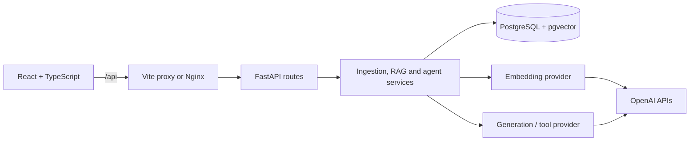

# DevDocs AI

**A technical documentation assistant with semantic search, cited answers and a bounded tool-using agent.**

DevDocs AI turns uploaded documentation into a searchable knowledge base. Users
upload text, Markdown or text-based PDFs, ask questions, and inspect the passages
behind each generated answer. The project combines a Python/FastAPI backend,
a React/TypeScript frontend and PostgreSQL with pgvector, with automated tests,
Docker Compose and GitHub Actions CI.

The core engineering problem is making generated answers **traceable to retrieved
evidence** while handling ingestion, indexing and model failures predictably.
Generated prose and source excerpts are returned separately; users can expand
citations to check what the documentation actually says.

[Architecture](docs/architecture.md) · [Demo](docs/demo.md) · [API reference](docs/api.md) · [Evaluation](evaluation/current-model-2026-10-12/README.md)


Actual application screenshot using [fictional AtlasDB documentation](examples/atlasdb-transactions.md)
and a live OpenAI response. The [demo guide](docs/demo.md) also shows insufficient
evidence and a tool-selected summary, with reproduction steps.

## Features

- **Document ingestion:** validate and extract UTF-8 TXT, Markdown and text-based
  PDF files up to 10 MiB; store metadata and ordered chunks with PDF page references.
- **Semantic retrieval:** batch-generate embeddings, persist vectors in pgvector,
  and search by cosine similarity with document and file-type filters.
- **RAG answers:** build bounded, deduplicated context and validate structured
  model output and citation references before returning an answer.
- **Inspectable sources:** expand citations to view the filename, chunk, page and
  actual excerpt; display an insufficient-evidence result when the pipeline declines.
- **Tool-using assistant:** let the model choose one validated read-only operation:
  retrieve documentation, inspect metadata or summarize a selected document.
- **Usable frontend:** upload/index controls, document library, question interface,
  search scope, loading states and useful failure messages.

## Engineering highlights

| Decision | Reason and trade-off |
| --- | --- |
| PostgreSQL + pgvector | Keep relational metadata, source text and vectors in one transactional database. Exact cosine search is simple at this scale; query cost grows with the collection. |
| Separate embedding and generation contracts | Keep provider logic out of API and service code. OpenAI is the implemented provider; changing embeddings requires re-indexing. |
| Atomic re-indexing | Validate every embedding batch before replacing stored vectors, preserving previous vectors on failure. Pending vectors remain in memory. |
| Short database transactions | Read source data and release the transaction before slow model HTTP calls, reducing connection occupancy. |
| Citation validation plus semantic evaluation | Reject invented source labels and mismatched references in code; separately review whether cited passages support each claim. |
| Bounded agent execution | Validate tool names and selected document scope, then execute one read-only tool. No autonomous loop or arbitrary SQL/shell execution. |
| Layered verification | Use fake providers for deterministic contracts, real PostgreSQL for persistence behavior, and live evaluation for model quality. |

Configuration and API keys stay on the backend. The application also includes
request correlation IDs, structured logs, provider timeouts, safe error responses,
versioned Alembic migrations and ordered container startup.

## Evaluation results

The [12 October 2026 evaluation](evaluation/current-model-2026-10-12/README.md) used
`text-embedding-3-small` (1536 dimensions) and `gpt-5.4-mini` on nine synthetic
questions across six fictional documents. Raw outputs, supplied context,
claim/source reviews and source fingerprints are committed alongside the results.

| Metric | Recorded result |
| --- | --- |
| Retrieval precision, macro across 7 labelled cases | **70.0%** |
| Evidence recall, macro across 7 labelled cases | **100%** |
| Groundedness | **16/16 reviewed claims supported** |
| Citation correctness | **16/16 reviewed claim/source pairs supported** |
| Expected answer/refusal status | **8/9 cases** |
| Operational errors | **0/9 cases** |

The remaining status failure is instructive: when the version was unspecified,
the model gave grounded limits for both versions instead of the dataset's expected
strict refusal. This is a policy mismatch, rather than an invented fact. Retrieval
also included distractors despite finding all labelled evidence.

These are **one run and one Codex AI source review**, not independent human review
or a general accuracy benchmark. The dataset does not evaluate long documents,
PDF extraction or agent routing. A valid citation does not by itself establish
semantic correctness. The [evaluation methodology](evaluation/README.md) defines
the denominators and rubric and preserves the historical embedding-model baseline.

## Architecture



**Ingestion:** validate → extract → chunk → persist text → explicit indexing →
batch embeddings → atomic vector update.

**RAG:** question → query embedding → cosine retrieval → context cleanup/budget →
LLM → citation validation → generated answer plus separate evidence.

**Agent:** question → model-selected tool → argument/scope validation → read-only
execution → database metadata or a grounded content response.

The backend is a modular monolith with API, service, persistence and AI boundaries.
[Architecture details](docs/architecture.md) include ingestion/RAG sequence diagrams,
the data model and design trade-offs.

| Layer | Technologies |
| --- | --- |
| Frontend | React, TypeScript, Vite |
| Backend | Python, FastAPI, Pydantic, HTTPX |
| Persistence | PostgreSQL, pgvector, SQLAlchemy, Alembic |
| AI | OpenAI `text-embedding-3-small`, `gpt-5.4-mini` |
| Verification | pytest, Vitest, React Testing Library, Ruff, ESLint |
| Infrastructure | Docker Compose, Nginx, GitHub Actions |

## Run locally with Docker

Prerequisites: Docker Engine/Desktop with Compose v2 and an OpenAI API key.
This is a locally tested, single-user MVP; a hosted demo is not provided.

From the repository root, copy the example **once**; keep an existing `.env`:

```bash
cp .env.example .env
```

Edit `.env` locally and set `POSTGRES_PASSWORD` and `OPENAI_API_KEY`. The example
selects `text-embedding-3-small` and `gpt-5.4-mini`. Keep secrets out of Git,
frontend code, `VITE_*` variables and Docker build arguments. Live AI operations
incur provider usage charges.

```bash
docker compose config --quiet
docker compose up --build --detach --wait --wait-timeout 120
```

Compose waits for PostgreSQL, applies migrations, then starts the backend and
frontend. First builds can take several minutes.

| Service | Default URL |
| --- | --- |
| Application | http://localhost:8080 |
| Interactive API documentation | http://localhost:8000/docs |
| OpenAPI schema | http://localhost:8000/openapi.json |
| Database readiness | http://localhost:8000/ready |

Try the project:

1. Upload `examples/atlasdb-transactions.md` using **Upload and index**.
2. Wait for **Ready for questions**, then ask “How do I discard uncommitted changes?”
3. Expand the citation and compare the answer with the excerpt.
4. Select the document, switch to assistant mode and ask “Summarize this document.”

Upload and indexing are separate operations. **Text ready** alone does not mean
searchable; indexing badges reflect the current browser session. Use **Index for
search** for existing documents and re-index after changing embedding models.

Stop while retaining documents:

```bash
docker compose down
```

The named volume retains document text and vectors; adding `--volumes` deletes it.
For port conflicts, runtime configuration and troubleshooting, see the
[operations guide](docs/production.md). Health/readiness checks do not test OpenAI
access or answer quality.

## Local development

Use Python 3.12–3.14, uv, and Node 24 (the CI version; minimum 22.12).
Start PostgreSQL from the repository root, then run the backend:

```bash
docker compose up --detach db
cd backend
uv sync --locked
uv run --locked alembic upgrade head
uv run --locked uvicorn app.main:create_app --factory --reload --no-access-log
```

In another terminal, from the repository root:

```bash
cd frontend
npm ci
npm run dev
```

Open http://127.0.0.1:5173. Vite proxies `/api` to the backend on port 8000;
use `POSTGRES_HOST=127.0.0.1` and the database's published port for native development.
Avoid running the full Compose application on the same ports as native servers.

## Testing and CI

Recorded local verification: **263 backend tests**, including **30 real PostgreSQL
integration tests**, and **29 frontend tests** passed, along with lint, formatting,
TypeScript/Vite build, Docker image builds and Compose smoke checks.

From `backend/`:

```bash
uv run --locked ruff check . ../scripts
uv run --locked ruff format --check . ../scripts
uv run --locked pytest -q
uv run --locked python -m evals validate
```

Without `TEST_DATABASE_URL`, database integration cases explicitly skip. The
[testing guide](docs/testing.md) explains how to run them in disposable databases.
From `frontend/`, run `npm test`, `npm run lint` and `npm run build`.

[GitHub Actions](.github/workflows/ci.yml) defines backend, frontend and container
jobs. CI uses fake model providers and disposable databases without paid AI calls;
live model evaluation is an explicit separate command. Deployment remains manual.
The local results above do not assert a successful hosted CI run.

## API and repository guide

The REST API exposes document upload/listing, chunk inspection, indexing, semantic
search, fixed RAG questions and agent questions, plus liveness/readiness endpoints.
See [request examples and error contracts](docs/api.md) or the
[generated OpenAPI snapshot](docs/openapi.json); the running schema is authoritative.

```text
backend/app/api/          HTTP validation and response contracts
backend/app/services/     Ingestion, retrieval, RAG and agent orchestration
backend/app/persistence/  Models, database sessions and queries
backend/app/ai/           Provider contracts and OpenAI adapters
backend/migrations/       Versioned PostgreSQL/pgvector schema
frontend/src/             React UI, HTTP client and interaction tests
evaluation/               Synthetic dataset and reviewed model runs
docs/                     Architecture, API, operations, demo and interview guides
examples/                 Fictional documentation for a reproducible demo
```

## Limitations and next steps

The shared collection has no authentication or tenant isolation. Public deployment
would require access controls, TLS termination, backups and operational safeguards.
Original uploaded binaries are not retained, and scanned PDFs require unsupported OCR.

Chunking uses character windows with overlap; it can split code and is not token-aware.
Retrieval uses exact vector search without a hybrid keyword stage or reranker.
Summaries cover the first five chunks within a 5000-character excerpt budget,
with partial-coverage notices. There is no conversation memory or streaming.
Ingestion/indexing run within requests rather than a durable job queue.

Priorities are broader held-out evaluation with independent review and repeated
runs, retrieval tuning, structure-aware chunking and durable ingestion jobs.
Approximate vector indexes should follow measured scale/latency needs. These are
future improvements, not implemented capabilities.

[Interview discussion guide](docs/interview.md) · [Agent design](docs/agent.md) · [Development journal](docs/development-journal.md)
