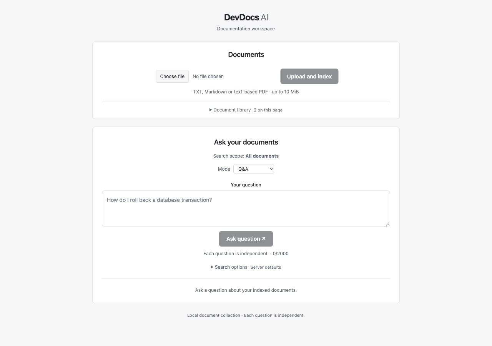
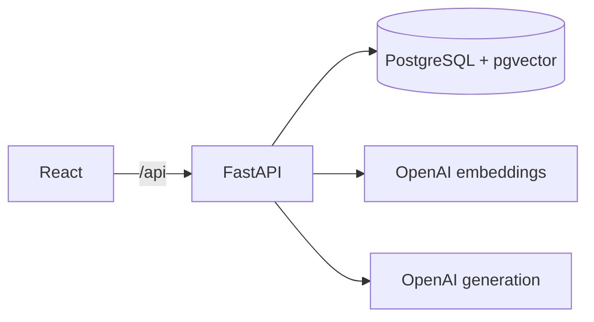

# DevDocs AI

Upload technical documentation, ask a question, and check the passages behind the
answer.

I built this project to learn how to take a RAG application beyond a basic model
API call: processing documents, storing embeddings, handling failed requests and
checking whether the answers are supported by their sources.

The backend uses Python, FastAPI and PostgreSQL with pgvector. The frontend is
React with TypeScript and Vite. OpenAI's `text-embedding-3-small` creates the
embeddings, and `gpt-5.4-mini` generates answers. Docker Compose runs the application
locally; GitHub Actions runs tests, lint and build checks.



[Demo walkthrough](docs/demo.md) · [Architecture](docs/architecture.md) · [API documentation](docs/api.md) · [Evaluation results](evaluation/current-model-2026-10-12/README.md)

## What it does

- Upload TXT, Markdown and text-based PDF files up to 10 MiB.
- Search across the collection or limit a question to a document or file format.
- Read an answer with expandable citations showing the filename, chunk, PDF page
  where available, and source text.
- Return an insufficient-evidence result when the pipeline cannot support an answer.
- In Assistant mode, choose between searching the documentation, reading document
  metadata and summarizing a selected document.

Each question is independent; there is no conversation memory. The
[demo](docs/demo.md) uses fictional documentation and includes examples of cited
answers and refusals. Its answer screenshots were taken before the current UI update.

## How it works

Documents are validated, extracted and split into overlapping chunks. Uploading
stores the text; a separate indexing request creates embeddings and writes them
to pgvector. The UI's **Upload and index** button runs both operations.

For a question, the backend embeds the query, retrieves chunks by cosine similarity,
removes duplicate or overlapping context, and sends a bounded set of excerpts to
the model. It checks the returned citation labels against those excerpts before
sending the answer and sources to the frontend.



The [architecture guide](docs/architecture.md) covers the data model, request flows
and boundaries between API, service, persistence and provider code.

A few decisions worth explaining:

- **One database for text, metadata and vectors.** PostgreSQL handles the relational
  data and transactions, while pgvector adds similarity search. Exact search keeps
  the implementation straightforward for a small collection; larger collections
  would need profiling and possibly an approximate index.
- **Re-indexing is atomic.** Every embedding batch must succeed and validate before
  existing vectors are replaced. A failed batch leaves the previous index intact,
  although pending vectors have to stay in memory until the write.
- **Model calls sit outside database transactions.** The service reads the required
  data and releases its transaction before waiting for the provider response.
- **Citation checks and answer quality are separate.** Rejecting an invented source
  label is deterministic. Deciding whether a real source supports a claim requires
  semantic review, which is part of the evaluation below.

Embedding and generation providers have separate interfaces, with OpenAI as the
current implementation. Changing the embedding model requires re-indexing documents.

The [assistant extension](docs/agent.md) makes one model-selected, read-only tool
call per request. The backend validates the tool name and document scope before
execution. Metadata comes directly from the database; summaries use stored excerpts.
There is no autonomous loop or arbitrary SQL or shell execution.

## Evaluation

On 12 October 2026, I ran the current models against nine synthetic questions and
six fictional documents. The [saved run](evaluation/current-model-2026-10-12/README.md)
includes the actual answers, retrieved context, claim reviews and configuration.

| Measure | Result |
| --- | --- |
| Retrieval precision, macro across 7 labelled cases | 70.0% |
| Evidence recall, macro across 7 labelled cases | 100% |
| Groundedness | 16/16 reviewed claims supported |
| Citation correctness | 16/16 reviewed claim/source pairs supported |
| Expected answer/refusal status | 8/9 |
| Operational errors | 0/9 |

The failed status case asked for an upload limit without specifying a version.
The model gave the documented limits for both versions, while the dataset expected
it to refuse. The answer was supported, but it did not follow that policy. Some
other questions retrieved irrelevant excerpts alongside the required evidence.

These results come from one run and one Codex AI source review, not independent
human review. Nine short synthetic cases do not establish general accuracy, and
they do not test long PDFs or agent routing. The [evaluation guide](evaluation/README.md)
explains the scoring rubric and keeps the earlier embedding-model run for comparison.

## Running the project

You need Docker Engine/Desktop with Compose v2 and an OpenAI API key. There is no
hosted demo; the application currently runs as a local, shared document collection.

From the repository root, create your configuration if you do not already have one:

```bash
cp .env.example .env
```

Set `POSTGRES_PASSWORD` and `OPENAI_API_KEY` in `.env`. The example already selects
`text-embedding-3-small` and `gpt-5.4-mini`. Keep `.env` out of version control;
provider keys stay on the backend. Live indexing and generation use API credits.

```bash
docker compose config --quiet
docker compose up --build --detach --wait --wait-timeout 120
```

Compose starts PostgreSQL, applies Alembic migrations, then starts the API and
frontend. First builds can take a few minutes.

- Application: http://localhost:8080
- Interactive API docs: http://localhost:8000/docs
- OpenAPI schema: http://localhost:8000/openapi.json

To try it:

1. Upload `examples/atlasdb-transactions.md` and wait for **Ready for questions**.
2. Ask “How do I discard uncommitted changes?” and expand the citation.
3. Open **Document library**, select the document, switch to **Assistant**, and
   ask “Summarize this document.”

For existing documents, **Text ready** means extraction succeeded, not necessarily
indexing. Use **Index for search** if needed. Indexing badges reflect this browser
session only.

```bash
docker compose down
```

This stops the application and keeps the database volume. Adding `--volumes`
deletes its stored documents and vectors. See the [operations guide](docs/production.md)
for port conflicts, configuration and troubleshooting.

<details>
<summary>Running the backend and frontend separately</summary>

Use Python 3.12–3.14, uv and Node 24 (minimum 22.12). Keep the same root `.env`.
From the repository root:

```bash
docker compose up --detach db
cd backend
uv sync --locked
uv run --locked alembic upgrade head
uv run --locked uvicorn app.main:create_app --factory --reload --no-access-log
```

In another terminal, from the repository root:

```bash
cd frontend
npm ci
npm run dev
```

Open http://127.0.0.1:5173. Vite proxies `/api` to port 8000. Use
`POSTGRES_HOST=127.0.0.1` and the database's published port for the native backend.
Stop the Compose API/frontend before starting native servers on the same ports.

</details>

## Tests

The recorded local checks passed 263 backend tests, including 30 PostgreSQL
integration tests, and 31 frontend tests. Tests cover upload validation, failed
indexing and retries, retrieval filters, citation validation, provider errors and
agent scope checks. Lint, frontend builds, image builds and Compose smoke checks
also passed.

From `backend/`:

```bash
uv run --locked ruff check . ../scripts
uv run --locked ruff format --check . ../scripts
uv run --locked pytest -q
uv run --locked python -m evals validate
```

Database tests skip unless `TEST_DATABASE_URL` is configured. They create and remove
disposable databases; the [testing guide](docs/testing.md) has the full instructions.
From `frontend/`, run `npm test`, `npm run lint` and `npm run build`.

[CI](.github/workflows/ci.yml) runs backend, frontend and container checks using
fake providers and disposable databases. Live model evaluation is separate from
CI so ordinary test runs do not need an API key or spend credits. The results
above are local verification records; check GitHub Actions for hosted run status.

## Limits and further work

There is no authentication, tenant isolation or public deployment yet. Documents
are stored as extracted text rather than original files, and scanned PDFs are
unsupported. A private multi-user deployment would need access controls, TLS,
backups and operational monitoring.

Chunks use character windows rather than document structure or token counts,
which can split code or lose useful context. Summaries cover the first five chunks
within a 5000-character excerpt budget. Uploading and indexing run inside requests,
without a durable job queue. Valid citations can still accompany unsupported claims.

The next useful work is broader evaluation with realistic held-out documents,
repeated runs and a second reviewer. That would give a better basis for retrieval
tuning, structure-aware chunking and background ingestion jobs.

More detail: [API contracts](docs/api.md), [repository architecture](docs/architecture.md),
[interview notes](docs/interview.md) and the [development journal](docs/development-journal.md).
