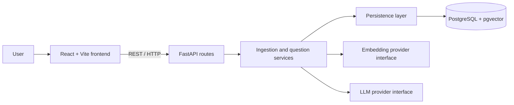

# DevDocs AI

A technical documentation assistant that retrieves relevant passages from uploaded
documents and uses a language model to produce answers with source citations.

**Status:** Milestone 3 — document ingestion complete. The backend validates
text, Markdown, and PDF uploads, extracts text, and stores metadata and chunks.
Documents and source chunks can be inspected through the API. Embeddings and
AI integration are not implemented yet.
This project is built one milestone at a time, with explanations and verification
before continuing.

## Problem and intended outcome

Developers need to find answers in technical documentation without losing the
ability to check the original source. DevDocs AI will make that process easier
by combining semantic retrieval with source-grounded generation.

The project also serves as an engineering learning portfolio: design decisions,
tests, evaluation results, and limitations will be documented alongside code.

## MVP requirements

- Upload UTF-8 `.txt`, `.md`, and text-based PDF documents.
- Validate file type, size, and extracted content; return useful errors for
  unsupported, empty, corrupt, or oversized files. Initial upload limit: 10 MiB.
- List uploaded documents and their ingestion status.
- Extract text, divide it into chunks, and store document and chunk metadata.
- Generate and persist embeddings for chunks.
- Accept one question per request and retrieve relevant chunks.
- Generate an answer using retrieved evidence, with citations identifying the
  document and chunk; retain PDF page references where extraction permits.
- Return the cited source excerpts separately from the generated answer so users
  can verify the claims.
- Explain when the available evidence does not support an answer.
- Provide a React interface with upload, document list, questions, answers,
  citations, and clear loading/error states.

The first usable RAG backend arrives in Milestone 5; the browser MVP arrives in
Milestone 6. Evidence handling is strengthened in Milestone 7 and measured in
Milestone 8. Portfolio readiness includes the later engineering and polish work.

### Initial scope boundaries

One user working with one shared document collection in a local development
environment. Questions are independent; conversation memory is outside the MVP.
There is no authentication or tenant isolation, so the initial system is not
intended for public deployment with private documents.

OCR for scanned PDFs, website crawling, document editing/deletion, streaming,
hybrid search, reranking, and distributed ingestion workers are outside the MVP.
Tool calling is reserved for Milestone 10. A simple RAG system comes first.

### Acceptance criteria

1. A supported document uploads, becomes searchable, and appears in the list.
2. A question whose answer exists in that document returns a relevant answer and
   citations that resolve to stored chunks and source excerpts.
3. A question without supporting evidence produces an explicit insufficient-
   evidence response; this behaviour is evaluated, not assumed.
4. Invalid uploads and provider failures return understandable errors without
   exposing credentials or internal stack traces.
5. Meaningful automated tests cover ingestion, retrieval, and answer/citation
   handling as those features are introduced.
6. Documented setup and CI checks make the finished project reproducible.

## Planned architecture

Use a modular monolith: one backend process with clear internal responsibilities.
This keeps deployment simple while allowing components to be tested separately.



### Two flows

**Ingestion:** upload → validate → extract text → chunk → embed → persist.

**Question answering:** question → embed → retrieve chunks → construct context
→ prompt LLM → validate citation references → return answer and sources.

Document status will distinguish processing, ready, and failed documents. Only
ready documents should contribute retrieval results. Ingestion starts with a
bounded request-based flow; a durable job queue is a later option if processing
times require it. Async HTTP code alone does not make CPU-heavy work nonblocking.

### Responsibilities and decisions

| Area | Responsibility and reason |
| --- | --- |
| API | Validate request/response shapes and map failures to HTTP responses. Keep orchestration out of route handlers. |
| Services | Coordinate ingestion and questions. Keep business rules testable without a browser. |
| Persistence | Store and query documents, chunks, and vectors. Keep database details out of provider code. |
| AI | Separate embedding and generation providers. Replacing an LLM should not require rewriting upload or database logic. |
| PostgreSQL + pgvector | Keep relational metadata and searchable vectors in one database, reducing infrastructure for this project. |
| React + Vite | Use the familiar frontend stack for a focused upload and question interface. |
| Configuration | Read environment settings in the backend; never send provider secrets to the browser. |
| Testing | Use deterministic provider substitutes for normal automated tests; run live-provider quality evaluations separately. |

Embeddings represent text as numerical vectors. Semantic search compares those
vectors to find passages related in meaning to a question. The LLM then generates
text using the retrieved passages. Retrieval and generation are separate steps
with separate failure modes.

Switching embedding models can change vector dimensions and the meaning of the
vector coordinates. Stored chunks must be re-embedded when the embedding model
changes; provider replacement is not automatically a configuration-only change.
Record model identity and chunking settings with ingestion data when implemented.

### Grounding and trust

Retrieved text is evidence, not executable instructions. Prompts will separate
the user's question from source passages and tell the model to answer only from
the supplied evidence. Citations will use stable chunk identifiers, and the
backend will check that references belong to the retrieved set. This checks
reference validity; evaluating whether a cited passage actually supports a
claim is a separate quality task. RAG reduces unsupported answers but does not
eliminate them.

### Database model — implemented in Milestone 2

- **Document:** UUID, filename, media type, size in bytes, processing/ready/failed
  status, optional safe error message, and timezone-aware creation/update times.
- **Chunk:** UUID, document UUID, zero-based position, text, optional one-based PDF
  page reference, and creation time.

One document has many chunks. A foreign key prevents orphan chunks; a unique
constraint prevents two chunks occupying the same position in a document. Its
index also supports querying chunks by document. Database check constraints
reject invalid sizes, statuses, positions, empty text/filenames, and page numbers.
Deleting a document cascades to its chunks; no deletion API is implemented yet.
UUIDs provide stable source identifiers independent of filename or text changes.
`updated_at` is refreshed by SQLAlchemy updates, not a database trigger; direct SQL
writers must set it themselves.

Embeddings, model/chunking metadata, vector dimensions, and similarity indexes
will be added in their own milestones. Enabling pgvector now does not generate
embeddings or make the current text rows semantically searchable.

## Directory structure

Current layout:

```text
DevDocs AI/
├── README.md
├── .gitignore
├── .env.example
├── compose.yaml             # local PostgreSQL + pgvector service
├── backend/
│   ├── pyproject.toml       # dependencies and test/lint configuration
│   ├── uv.lock              # exact resolved dependency versions
│   ├── alembic.ini          # migration configuration
│   ├── migrations/          # env.py, revision template, and versioned schema
│   ├── app/
│   │   ├── __init__.py
│   │   ├── main.py          # create_app factory
│   │   ├── api/
│   │   │   ├── __init__.py
│   │   │   ├── health.py    # liveness/readiness routes
│   │   │   ├── documents.py # upload and inspection routes
│   │   │   └── document_schemas.py
│   │   ├── core/
│   │   │   ├── __init__.py
│   │   │   └── config.py    # typed environment settings
│   │   ├── services/
│   │   │   ├── __init__.py
│   │   │   ├── ingestion.py
│   │   │   ├── extraction.py
│   │   │   ├── chunking.py
│   │   │   └── document_errors.py
│   │   └── persistence/
│   │       ├── __init__.py
│   │       ├── database.py # connection pool and request sessions
│   │       ├── models.py   # document and chunk tables
│   │       └── documents.py # persistence queries
│   └── tests/
│       ├── conftest.py
│       ├── test_health.py
│       ├── test_config.py
│       ├── test_database_config.py
│       ├── test_readiness.py
│       ├── test_chunking.py
│       ├── test_extraction.py
│       ├── test_document_api.py
│       └── integration/
│           └── test_database.py
└── frontend/
    └── .gitkeep
```

Planned backend layout, created only as each part becomes necessary:

```text
backend/
├── app/
│   ├── main.py        # application entry point
│   ├── api/           # routes and request/response schemas
│   ├── core/          # configuration and shared error/logging setup
│   ├── services/      # ingestion and question orchestration
│   ├── persistence/   # database models, connection, and queries
│   └── ai/            # embedding and LLM provider boundaries
├── tests/
└── migrations/
```

Frontend source layout will be chosen when Vite is scaffolded in Milestone 6.
CI workflows and evaluation data arrive in their own milestones.
Compose currently runs the database only; application containers arrive later.
Prefer small modules and simple functions/classes; do not introduce a generic
framework or a separate service for every responsibility.

FastAPI supports grouping routes in modules using `APIRouter`; see its
[Bigger Applications guide](https://fastapi.tiangolo.com/tutorial/bigger-applications/).

## Configuration and secrets

The backend reads optional settings from `.env` in the repository root. Its path
is resolved relative to `config.py`, so it does not depend on the shell's working
directory. Copy `.env.example` to `.env` if you want to change defaults.

| Variable | Default | Purpose |
| --- | --- | --- |
| `APP_NAME` | `DevDocs AI` | API title in generated documentation; must be nonempty. |
| `APP_ENV` | `development` | Environment label: `development`, `test`, or `production`. |
| `POSTGRES_HOST` | `127.0.0.1` | Host address used by the locally running backend. |
| `POSTGRES_PORT` | `5432` | Host port; valid range 1–65535. |
| `POSTGRES_DB` | `devdocs` | Database name. |
| `POSTGRES_USER` | `devdocs` | Local database user. |
| `POSTGRES_PASSWORD` | unset | Required for database setup; set a nonempty local value. |
| `MAX_UPLOAD_BYTES` | `10485760` | Maximum file content size: 10 MiB. |
| `MAX_EXTRACTED_CHARS` | `1000000` | Maximum extracted document characters. |
| `MAX_PDF_PAGES` | `200` | Maximum PDF page count. |
| `CHUNK_SIZE` | `1000` | Characters per chunk; valid range 100–10000. |
| `CHUNK_OVERLAP` | `150` | Repeated characters; must be nonnegative and smaller than chunk size. |

`APP_ENV` does not automatically enable production security or change logging.
Logging and provider settings will be added when needed. Configuration
precedence is explicit constructor values → environment variables → `.env` →
defaults. Invalid values prevent application creation rather than silently using
a fallback. Unknown dotenv keys are ignored so the root file can eventually hold
settings for other components.

A developer's `.env` is ignored by Git. Real keys must never appear in tracked
files, logs, screenshots, or frontend configuration.

## Development and verification

Prerequisites: Python 3.12–3.14, [uv](https://docs.astral.sh/uv/), and Docker
with Compose. Docker Desktop must be running for database commands.
The backend is an application, not a published Python package. Commands below
run from `backend/`; uv manages its ignored `.venv` directory. The checked-in
lockfile pins resolved versions; `--locked` rejects stale dependency metadata.

From the repository root:

```sh
cp -n .env.example .env
# Edit .env and set POSTGRES_PASSWORD to your own nonempty local password.
docker compose up -d --wait db
cd backend
uv sync --locked
uv run --locked alembic upgrade head
uv run --locked uvicorn app.main:create_app --factory --reload
```

If `.env` already exists, keep it and add the database settings instead of copying
over it. A blank password is invalid; omitting the password allows liveness-only
API use and causes `/ready` to return 503. Compose requires the password.
If port 5432 is occupied, change `POSTGRES_PORT` in `.env`; both the port mapping
and backend connection use it.

Visit [interactive API docs](http://127.0.0.1:8000/docs), or check:

```sh
curl http://127.0.0.1:8000/health
# {"status":"ok"}
```

The server uses Uvicorn, which runs the FastAPI ASGI application. `--factory`
invokes `create_app()` at startup; `--reload` is for local development.
`GET /health` is a **liveness** check: HTTP 200 means the API can respond. It does
not verify database connectivity or AI provider availability. `GET /ready` executes
`SELECT 1` and returns 200 if the database is reachable, or a useful 503 response
if it is unavailable/unconfigured. It does not verify migration state or AI
provider availability. Apply migrations before using future database features.

Run checks from `backend/`:

```sh
uv run --locked pytest
uv run --locked ruff check .
uv run --locked ruff format --check .
```

Tests use FastAPI's in-process `TestClient`; no network server is needed. They
check the health response and OpenAPI contract, configuration defaults and source
precedence, rejection of invalid environments, and settings supplied to the
application factory. Fixtures isolate tests from developer environment settings.
No frontend build or Python package build exists at this milestone.

Without `TEST_DATABASE_URL`, 18 database integration cases are explicitly skipped;
52 non-integration tests still run. To exercise all 70 tests against the local
Compose database, run this from `backend/` (it reads `.env` without printing the
password):

```sh
uv run --locked python - <<'PYTEST'
import os
import pytest
from app.core.config import Settings

os.environ["TEST_DATABASE_URL"] = Settings().database_url.render_as_string(
    hide_password=False
)
raise SystemExit(pytest.main(["-q"]))
PYTEST
```

Alternatively supply `TEST_DATABASE_URL` using the `postgresql+psycopg` scheme
through your environment. Use a local/test server and a user allowed to create
and drop databases and enable pgvector. Each integration case creates a uniquely
named disposable database and drops only that database after the test. Cases
verify extension availability, migration downgrade/reapply, model/schema
agreement, persistence, constraints, cascade deletion, readiness, and request
session commit/rollback, upload-to-chunk persistence, pagination, and atomic
rollback on failed chunk writes. SQLite cannot validate these PostgreSQL-specific features.

Milestone 2 verification: all 28 tests passed on Python 3.14.7 with PostgreSQL 17
and pgvector 0.8.2; Ruff lint/format checks and `alembic check` passed.

Documentation consulted: [FastAPI testing](https://fastapi.tiangolo.com/tutorial/testing/),
[Pydantic settings](https://docs.pydantic.dev/latest/concepts/pydantic_settings/),
and [uv projects](https://docs.astral.sh/uv/guides/projects/).

## Roadmap

| Milestone | Deliverable | Status |
| --- | --- | --- |
| 0 | Requirements, MVP scope, architecture, repository skeleton | Complete |
| 1 | FastAPI, health endpoint, configuration, pytest foundation | Complete |
| 2 | Compose database, PostgreSQL + pgvector, models, migrations | Complete |
| 3 | Validated uploads, text extraction, metadata, chunking | Complete |
| 4 | Embeddings, vector persistence, semantic retrieval | Planned |
| 5 | Basic RAG pipeline with source citations | Planned |
| 6 | React upload, document list, questions, answers, and sources | Planned |
| 7 | Retrieval settings, filters, context cleanup, insufficient-evidence handling | Planned |
| 8 | Evaluation dataset: retrieval relevance, groundedness, citation correctness | Planned |
| 9 | Service containers, CI, automated checks, logging, error/secrets handling | Planned |
| 10 | Simple assistant using retrieval, metadata, and summary tools | Planned |
| 11 | Setup guide, screenshots, API docs, decisions, limitations, interview notes | Planned |

## Evaluation — planned

Use a small versioned document/question dataset with expected supporting chunks.
Measure retrieval relevance separately from answer groundedness and citation
correctness so a fluent answer cannot hide poor retrieval. Include unanswerable
questions. Definitions, scoring, and results arrive in Milestone 8.

## Limitations and future work

The backend exposes document ingestion/inspection, health, database readiness,
and generated API documentation. It does not yet answer questions or embed text. The MVP scope excludes scanned PDFs and multi-user access. Model context limits, provider cost/latency, upload processing
time, prompt injection, and retrieval quality will inform later decisions.
Local models are a future provider option; none is selected or installed now.

## Interview notes — Milestone 0

- Explain why a modular monolith fits the project better than multiple services.
- Trace ingestion and question answering as separate flows.
- Explain why embeddings retrieve evidence while the LLM generates an answer.
- Explain why a valid citation identifier does not prove a claim is supported.
- Explain why model changes can require re-embedding the stored collection.

Screenshots, detailed API documentation, measured results, and final interview
talking points will be added once the relevant features exist.


## Interview notes — Milestone 1

- **Application factory:** `create_app()` constructs a fresh API and loads settings
  only when called. Tests can inject configuration without import-time side effects.
- **Typed response:** `HealthResponse` describes the public JSON contract; FastAPI
  uses the return annotation for response validation and OpenAPI documentation.
- **HTTP semantics:** the health check uses GET because it reads status without
  changing data, and returns 200 when the API responds successfully.
- **Configuration:** separate deployment settings from code and validate them at
  startup. Never return the full settings object through an API endpoint.
- **Async:** the health route uses `async def` and does no blocking work. Async
  becomes useful for waiting on I/O; it does not speed up CPU-heavy extraction.
- **Testing:** in-process HTTP tests exercise routing and serialization. They do
  not replace testing a real server; a local server smoke check covers startup.
- **Dependencies:** `pyproject.toml` declares supported ranges; `uv.lock` records
  exact versions. Development tools are separated from runtime dependencies.


## Database operations and design decisions — Milestone 2

The Compose service uses `pgvector/pgvector:0.8.2-pg17-trixie`: PostgreSQL 17 with
the extension installed. Migration `0001` enables it in the application database
with `CREATE EXTENSION IF NOT EXISTS vector`. The named volume keeps database
files across container recreation. Only localhost can reach the published port.
The Compose health check tests server availability; it does not apply migrations.
See the [Compose service reference](https://docs.docker.com/reference/compose-file/services/)
and [pgvector documentation](https://github.com/pgvector/pgvector).

From the repository root, `docker compose stop db` stops the service while
retaining its volume; `docker compose up -d --wait db` starts it again.
The initial `POSTGRES_*` values initialize a new volume. Changing those values in
`.env` does not change credentials or database names inside an existing volume.
This local setup uses the image's administrative user. A deployed application
should use a restricted runtime role and a separate migration role.

SQLAlchemy's async engine owns a reusable connection pool. FastAPI's lifespan
creates it once and disposes it at shutdown. `pool_pre_ping` checks pooled
connections before reuse. An engine is not a session: each request receives a
new `AsyncSession`, and successful writes must explicitly commit. Closing the
session rolls back uncommitted work, including when a handler raises an error.
A session must not be shared across concurrent requests. `expire_on_commit=False`
keeps loaded values accessible after commit without an implicit async reload.
See [SQLAlchemy async support](https://docs.sqlalchemy.org/en/20/orm/extensions/asyncio.html).

Alembic applies versioned schema changes separately from server startup:

```sh
# From backend/
uv run --locked alembic current
uv run --locked alembic upgrade head
uv run --locked alembic check
# For later schema changes, generate and review a candidate migration:
uv run --locked alembic revision --autogenerate -m "describe schema change"
```

Autogeneration is a starting point requiring review; extension operations are
written explicitly. The revision template supports future migrations.
`alembic downgrade base` drops documents and chunks, so it should only be used
on disposable databases; tests exercise it there. The downgrade deliberately
retains pgvector because unrelated tables could depend on it.
See [Alembic's async migration recipe](https://alembic.sqlalchemy.org/en/latest/cookbook.html#using-asyncio-with-alembic).

## Interview notes — Milestone 2

- **Vector database:** stores numerical representations and finds neighbours by
  a distance/similarity metric. An embedding model produces the numbers; the
  database stores and searches them. It does not generate embeddings itself.
- **pgvector:** adds vector types and similarity operations to PostgreSQL, so
  relational document metadata and vectors can share transactions and joins.
- **Migration vs model:** the model describes the desired mapping; a migration
  records how to change an existing database. Editing a model does not alter a table.
- **Foreign key vs validation:** API checks give useful errors; database constraints
  protect integrity even if writes bypass the API.
- **Transaction:** a group of writes either commits or rolls back. In later ingestion
  work this helps prevent partially saved document/chunk collections.
- **Connection pool vs session:** the pool reuses connections; a session tracks one
  unit of work. Async I/O lets the server handle other requests while waiting for SQL.
- **Scope:** no uploads, vector column, embedding provider, or semantic search yet.


## Document ingestion — Milestone 3

| Method and path | Behaviour |
| --- | --- |
| `POST /documents` | Multipart field `file`; extracts and saves a document and its chunks; returns metadata with HTTP 201. |
| `GET /documents` | Metadata and chunk counts, newest first; `limit` (1–100, default 20) and `offset` (default 0). |
| `GET /documents/{id}/chunks` | Source chunk IDs, text, positions, and PDF pages, ordered by position; same pagination parameters. |

With the API running, from the repository root:

```sh
curl -F 'file=@README.md;type=text/markdown' http://127.0.0.1:8000/documents
curl 'http://127.0.0.1:8000/documents?limit=20&offset=0'
# Replace DOCUMENT_UUID with the id returned by the upload:
curl 'http://127.0.0.1:8000/documents/DOCUMENT_UUID/chunks?limit=100'
```

Upload responses contain `id`, `filename`, canonical `media_type`, `size_bytes`,
`status`, timestamps, and `chunk_count`. Chunk responses contain `id`,
`document_id`, zero-based `position`, `text`, and one-based `source_page` (null for
text/Markdown). A status of `ready` currently means text ingestion is complete;
it does not mean embeddings exist or the document is searchable yet.

### Validation and error behaviour

The server rejects filenames containing paths or controls, unsupported extensions,
conflicting declared MIME types, empty/whitespace-only documents, invalid UTF-8,
and unsupported text controls. UTF-8 BOMs are accepted and newlines are normalized;
Markdown syntax, code indentation, and Unicode text are preserved. Extensions
and MIME types are hints: validation also checks the contents. Generic
`application/octet-stream` is accepted when the supported extension/content match.

PDF validation checks the header, parseability, encryption, page count, readable
text, and extracted-text limits. The parser additionally rejects pages whose
decoded content stream exceeds 5 MiB before text extraction. Blank pages are
skipped while retaining original page numbers. Encrypted, corrupt, and PDFs with
no readable text are rejected. There is no OCR; text order in multi-column PDFs
and tables depends on the parser and may be imperfect.
See [pypdf text extraction](https://pypdf.readthedocs.io/en/stable/user/extract-text.html).

| Status | Meaning |
| --- | --- |
| 400 | Empty, unreadable, corrupt, encrypted, or otherwise invalid content/filename. |
| 413 | File, extracted text, PDF page count, or decoded page stream exceeds a limit. |
| 415 | Unsupported extension or conflicting type/content. |
| 404 | Requested document does not exist. |
| 422 | Missing multipart field or invalid UUID/pagination. |
| 503 | Database is unconfigured or a database operation failed. |

Rejected uploads create no rows. Successful metadata and all chunks are committed
in one transaction; a database failure rolls the transaction back. Since ingestion
finishes within the request, this milestone does not persist intermediate
`processing` or rejected `failed` rows. Duplicate uploads intentionally create
separate documents; deduplication is deferred.

### Chunking and async processing decisions

`chunk_sections()` uses character windows. For size 1000 and overlap 150, the
first window starts at 0, the next at 850, and so on. The final chunk may be
shorter; it does not emit an unnecessary tail containing only overlap. Empty
windows are omitted. PDF pages are chunked separately so a chunk has one precise
source page. This loses some context across page boundaries, a trade-off to
revisit during retrieval evaluation.

Smaller chunks focus the evidence but may separate a concept from its explanation.
Larger chunks retain context but may dilute relevance and use more LLM context.
Overlap reduces boundary loss while increasing repeated text and storage.
Character count is not token count: a tokenizer may represent code or Unicode
with different numbers of tokens. Fixed windows can split sentences and code
blocks; structural/token-aware splitting is a later quality improvement.
Chunk settings currently come from configuration and are not recorded per document.

The API reads at most `MAX_UPLOAD_BYTES + 1` file bytes to detect oversized files,
then closes the upload handle. FastAPI's multipart parser may spool the incoming
upload before the handler runs: this is a file-processing limit, not a total HTTP
body/network limit. Public deployment needs an upstream request-size limit.
See [FastAPI file uploads](https://fastapi.tiangolo.com/tutorial/request-files/).

The service runs extraction and chunking in a worker thread, then uses the async
SQLAlchemy session for persistence. This keeps blocking parsing off the request
event loop; it does not make PDF parsing faster or create a durable background job.
PDF limits reduce ordinary resource use but cannot guarantee a hard CPU/memory
bound during decompression/parsing. Process isolation/time limits are future work
before accepting hostile public uploads. Original files are not retained; only
metadata and extracted chunks are stored.

### Verification and interview notes

Milestone 3 verification: all 70 tests passed, including 18 PostgreSQL integration
cases; Ruff lint and formatting passed. New checks cover overlap/tail handling,
code indentation, PDF pages/encryption/limits, invalid uploads, exact upload-size
boundaries, stored metadata/chunks, pagination, and database-write rollback.

Explain the ingestion flow as: validate → extract → chunk → atomically persist.
Keep HTTP error translation in API routes, orchestration in the ingestion service,
pure extraction/chunking functions in services, and SQL queries in persistence.
Stable chunk IDs and PDF page references prepare us for source citations; they do
not yet prove an answer is grounded. Embeddings and retrieval begin in Milestone 4.
