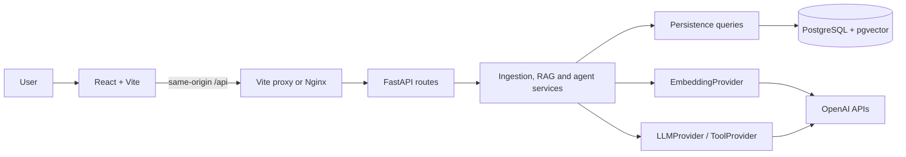

# DevDocs AI

**Ask technical documentation. Check the evidence behind the answer.**

DevDocs AI is a local documentation assistant that combines semantic retrieval
with source-grounded generation. Upload a text, Markdown or text-based PDF file,
index its chunks, and ask questions with citations linking back to the exact
excerpts. An optional assistant can choose retrieval, metadata inspection or a
cited summary of a selected document.

**Status:** Milestones 0–11 complete. This is a portfolio-ready local, single-user
MVP, not a publicly deployed multi-tenant service. Runtime AI providers are OpenAI
only: `gpt-5.4-mini` generates answers and `text-embedding-3-small` generates
1536-dimensional vectors. No Ollama installation is required.


The screenshot uses [fictional AtlasDB documentation](examples/atlasdb-transactions.md)
and a live OpenAI response in a disposable database. It illustrates provenance,
not a general accuracy guarantee. [More screenshots and reproduction steps](docs/demo.md).

## What you can try

- Upload UTF-8 `.txt`/`.md` or text-based PDF documents up to 10 MiB.
- Index documents and search by meaning rather than exact keywords.
- Ask questions across the collection or restrict them by document/file type.
- Expand citations to inspect filenames, chunk positions, PDF pages and excerpts.
- Receive an explicit insufficient-evidence result when the pipeline declines.
- Use assistant mode for verified metadata or a bounded document summary.

Upload and indexing are separate backend operations. The UI's **Upload and index**
button performs both; **Text ready** alone does not prove a document is searchable.
Indexing badges describe the current browser session. For existing documents,
use **Index for search**. Re-index after changing embedding models or dimensions.

## Quick start with Docker

Install Docker Engine/Desktop with Compose v2 or newer. From a local clone's root,
copy the example once; keep an existing `.env` when returning to the project:

```bash
cp .env.example .env
```

Edit `.env` locally. Set a nonempty `POSTGRES_PASSWORD` and your `OPENAI_API_KEY`.
The example already selects the models above. Keep credentials out of Git,
browser code, `VITE_*` variables and Docker build arguments.

```bash
docker compose config --quiet
docker compose up --build --detach --wait --wait-timeout 120
```

Compose starts PostgreSQL, waits for readiness, runs Alembic migrations, then
starts the API and frontend. First builds can take several minutes.

| Service | Default URL |
| --- | --- |
| Application | http://localhost:8080 |
| Interactive API documentation | http://localhost:8000/docs |
| Alternative API documentation | http://localhost:8000/redoc |
| OpenAPI schema | http://localhost:8000/openapi.json |
| Database readiness | http://localhost:8000/ready |

Upload `examples/atlasdb-transactions.md`, then ask:
**“How do I discard uncommitted changes?”** Expand its citation to check the answer.
In assistant mode, select the document and ask **“Summarize this document.”**

Stop while retaining documents:

```bash
docker compose down
```

Named volumes retain document text and vectors. Adding `--volumes` deletes them.
If ports are occupied, stop the competing local service or change `POSTGRES_PORT`,
`BACKEND_PORT` and `FRONTEND_PORT` in `.env`; Compose maps the database internally
to `db:5432`. Changing a password does not reset an initialized database's password.
Health/readiness checks do not call OpenAI; missing credentials cause a useful
error when an AI operation is attempted. [Detailed operations guide](docs/production.md).

## Local development

Use Python 3.12–3.14, uv, and Node 24 (the CI version). Node must be at least
22.12. Start the database from the repository root, then run the backend:

```bash
docker compose up --detach db
cd backend
uv sync --locked
uv run --locked alembic upgrade head
uv run --locked uvicorn app.main:create_app --factory --reload --no-access-log
```

In another terminal, from the repository root:

```bash
cd frontend
npm ci
npm run dev
```

Open http://127.0.0.1:5173. Vite proxies `/api` to port 8000; Nginx does the same
in Docker. Keep the native backend on port 8000 for this development proxy, and
use `POSTGRES_HOST=127.0.0.1` with the database's published port. Do not run the
full Compose frontend/backend on the same ports as local development servers.

## Architecture and engineering decisions



**Ingestion:** validate → extract → chunk → persist text. Explicit indexing then
embeds ordered batches and atomically writes vectors.

**RAG:** question → embedding → cosine search → deduplicate/budget context →
LLM → citation validation → answer plus separate evidence.

**Assistant:** question → one tool choice → validate name/scope → read-only tool →
verified metadata or one grounded generation. [Architecture details](docs/architecture.md).

| Decision | Why, and the trade-off |
| --- | --- |
| Modular monolith | API, service, persistence and provider boundaries remain testable without the operational overhead of separate services |
| PostgreSQL + pgvector | Relational metadata and vectors share transactions; exact search is simple but scans compatible vectors as the collection grows |
| Separate embedding/generation contracts | Retrieval and generation perform different jobs; changing embeddings requires re-indexing, while changing generation does not |
| Character chunks with overlap | Simple, deterministic and preserves page references; boundaries can split code and characters do not predict token counts reliably |
| Atomic re-indexing | All batches must validate before existing vectors change; this preserves previous vectors on failure but holds pending vectors in memory |
| Short DB transactions | Snapshot source data and release read transactions before model HTTP calls; avoids occupying a database connection during slow inference |
| Strict output plus citation checks | Reject malformed answers and invented reference labels; this does not prove that a cited passage supports the claim |
| One read-only agent tool | Demonstrates model-directed execution with scope validation and bounded calls; cannot handle multi-step tasks in one request |

The embedding model maps text to vectors. Cosine similarity compares their
**direction**, enabling semantically related passages to match without sharing
keywords. A similarity score is not answer confidence. The configured 0.35 cutoff
is a heuristic that needs evaluation for the current model and corpus.

## API

| Method | Path | Purpose |
| --- | --- | --- |
| GET | `/health`, `/ready` | API liveness / database connectivity |
| POST / GET | `/documents` | Upload / paginated metadata list |
| GET | `/documents/{id}/chunks` | Inspect stored source text |
| POST | `/documents/{id}/index` | Generate and store document embeddings |
| POST | `/search` | Retrieve source chunks without generation |
| POST | `/questions` | Fixed RAG with validated citations |
| POST | `/agent/questions` | Optional one-tool assistant |

[API examples, response contracts and errors](docs/api.md).
[Committed OpenAPI snapshot](docs/openapi.json); the running API's schema is authoritative.

## Testing, CI and evaluation

From `backend/`:

```bash
uv run --locked ruff check . ../scripts
uv run --locked ruff format --check . ../scripts
uv run --locked pytest -q
uv run --locked python -m evals validate
```

Without `TEST_DATABASE_URL`, PostgreSQL integration cases are explicitly skipped.
[Run the full suite safely against disposable databases](docs/testing.md).
From `frontend/`, run `npm test`, `npm run lint` and `npm run build`.

Local verification: **263 backend tests (30 database integration cases)** and
**29 frontend tests** passed, as did lint, TypeScript/Vite, image builds and the
Compose smoke. Mock providers test failure and citation contracts deterministically;
live smoke checks demonstrate provider wiring using a tiny fictional document.

[GitHub Actions](.github/workflows/ci.yml) runs backend, frontend and container jobs
with disposable databases and no paid AI calls. This implements **CI**; deployment
is manual. A checked-in workflow is not evidence of a successful hosted run.

The [current-model nine-question evaluation](evaluation/current-model-2026-10-12/README.md)
uses `text-embedding-3-small` (1536 dimensions) and GPT-5.4 mini. One live run recorded
**70.0% retrieval precision**, **100% evidence recall**, **16/16 supported claims**
and **16/16 supporting citation pairs**, with **8/9 expected statuses** and no
operational errors. Semantic scores come from one Codex AI source review, not
independent human review. Nine synthetic cases do not establish general accuracy
or agent quality.

The [frozen historical run](evaluation/README.md#historical-recorded-baseline) remains
available for comparison. Dataset, prompt and retrieval settings match; historical
code/environment and provider snapshots are not established as identical. A
single-run difference does not prove that changing embeddings caused an improvement.

## Limitations and next improvements

This local MVP has no authentication, tenant isolation, TLS termination, backups
or public deployment. Uploaded files are extracted to database text; original file
binaries are not retained. Scanned PDFs need OCR, which is unsupported.

Grounding remains probabilistic: retrieval can omit relevant evidence, document
instructions can influence a model, and valid citations can accompany unsupported
claims. Summaries use the first five chunks and a 5000-character excerpt budget,
with visible partial-coverage notices. There is no conversation memory, streaming,
document deletion API, hybrid search or reranker. Ingestion/indexing happen within
requests, with per-call timeouts and no durable queue; a client timeout does not
turn the request into a recoverable background job.

Priorities for further work are broader, repeated current-model evaluation, retrieval tuning,
structure-aware chunking, then durable ingestion jobs. Add auth/tenant filtering,
backups and deployment controls before introducing private multi-user access.
Use approximate indexes only after measuring a collection size that justifies
them. These are proposed improvements, not implemented features.

## Explore the code and explain the project

```text
backend/app/api/          HTTP validation and response contracts
backend/app/services/     Ingestion, retrieval, RAG and agent orchestration
backend/app/persistence/  SQLAlchemy models, sessions and queries
backend/app/ai/           Provider contracts and OpenAI HTTP adapters
backend/migrations/       Versioned PostgreSQL/pgvector schema
frontend/src/             React UI, HTTP client and interaction tests
evaluation/               Synthetic corpus, questions and reviewed model runs
docs/                     Architecture, API, operations, demo and interview guides
examples/                 Fictional documentation for a reproducible demo
```

[Interview talking points](docs/interview.md) cover embeddings, chunking, cosine
search, hallucination, context limits, async processing, REST, database design,
testing, Docker, CI and tool calling—with concrete code pointers and trade-offs.
[Development journal](docs/development-journal.md) preserves the milestone-by-milestone
learning history. [Agent guide](docs/agent.md) explains the optional extension.
