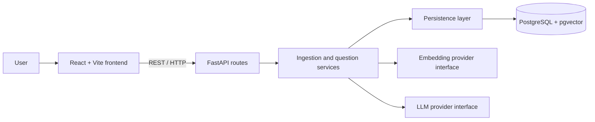

# DevDocs AI

A technical documentation assistant that retrieves relevant passages from uploaded
documents and uses a language model to produce answers with source citations.

**Status:** Milestone 0 — planning and repository setup. No application, database,
or AI integration is implemented yet. This project is built one milestone at a
time, with explanations and verification before continuing.

## Problem and intended outcome

Developers need to find answers in technical documentation without losing the
ability to check the original source. DevDocs AI will make that process easier
by combining semantic retrieval with source-grounded generation.

The project also serves as an engineering learning portfolio: design decisions,
tests, evaluation results, and limitations will be documented alongside code.

## MVP requirements

- Upload UTF-8 `.txt`, `.md`, and text-based PDF documents.
- Validate file type, size, and extracted content; return useful errors for
  unsupported, empty, corrupt, or oversized files. Initial upload limit: 10 MiB.
- List uploaded documents and their ingestion status.
- Extract text, divide it into chunks, and store document and chunk metadata.
- Generate and persist embeddings for chunks.
- Accept one question per request and retrieve relevant chunks.
- Generate an answer using retrieved evidence, with citations identifying the
  document and chunk; retain PDF page references where extraction permits.
- Return the cited source excerpts separately from the generated answer so users
  can verify the claims.
- Explain when the available evidence does not support an answer.
- Provide a React interface with upload, document list, questions, answers,
  citations, and clear loading/error states.

The first usable RAG backend arrives in Milestone 5; the browser MVP arrives in
Milestone 6. Evidence handling is strengthened in Milestone 7 and measured in
Milestone 8. Portfolio readiness includes the later engineering and polish work.

### Initial scope boundaries

One user working with one shared document collection in a local development
environment. Questions are independent; conversation memory is outside the MVP.
There is no authentication or tenant isolation, so the initial system is not
intended for public deployment with private documents.

OCR for scanned PDFs, website crawling, document editing/deletion, streaming,
hybrid search, reranking, and distributed ingestion workers are outside the MVP.
Tool calling is reserved for Milestone 10. A simple RAG system comes first.

### Acceptance criteria

1. A supported document uploads, becomes searchable, and appears in the list.
2. A question whose answer exists in that document returns a relevant answer and
   citations that resolve to stored chunks and source excerpts.
3. A question without supporting evidence produces an explicit insufficient-
   evidence response; this behaviour is evaluated, not assumed.
4. Invalid uploads and provider failures return understandable errors without
   exposing credentials or internal stack traces.
5. Meaningful automated tests cover ingestion, retrieval, and answer/citation
   handling as those features are introduced.
6. Documented setup and CI checks make the finished project reproducible.

## Planned architecture

Use a modular monolith: one backend process with clear internal responsibilities.
This keeps deployment simple while allowing components to be tested separately.



### Two flows

**Ingestion:** upload → validate → extract text → chunk → embed → persist.

**Question answering:** question → embed → retrieve chunks → construct context
→ prompt LLM → validate citation references → return answer and sources.

Document status will distinguish processing, ready, and failed documents. Only
ready documents should contribute retrieval results. Ingestion starts with a
bounded request-based flow; a durable job queue is a later option if processing
times require it. Async HTTP code alone does not make CPU-heavy work nonblocking.

### Responsibilities and decisions

| Area | Responsibility and reason |
| --- | --- |
| API | Validate request/response shapes and map failures to HTTP responses. Keep orchestration out of route handlers. |
| Services | Coordinate ingestion and questions. Keep business rules testable without a browser. |
| Persistence | Store and query documents, chunks, and vectors. Keep database details out of provider code. |
| AI | Separate embedding and generation providers. Replacing an LLM should not require rewriting upload or database logic. |
| PostgreSQL + pgvector | Keep relational metadata and searchable vectors in one database, reducing infrastructure for this project. |
| React + Vite | Use the familiar frontend stack for a focused upload and question interface. |
| Configuration | Read environment settings in the backend; never send provider secrets to the browser. |
| Testing | Use deterministic provider substitutes for normal automated tests; run live-provider quality evaluations separately. |

Embeddings represent text as numerical vectors. Semantic search compares those
vectors to find passages related in meaning to a question. The LLM then generates
text using the retrieved passages. Retrieval and generation are separate steps
with separate failure modes.

Switching embedding models can change vector dimensions and the meaning of the
vector coordinates. Stored chunks must be re-embedded when the embedding model
changes; provider replacement is not automatically a configuration-only change.
Record model identity and chunking settings with ingestion data when implemented.

### Grounding and trust

Retrieved text is evidence, not executable instructions. Prompts will separate
the user's question from source passages and tell the model to answer only from
the supplied evidence. Citations will use stable chunk identifiers, and the
backend will check that references belong to the retrieved set. This checks
reference validity; evaluating whether a cited passage actually supports a
claim is a separate quality task. RAG reduces unsupported answers but does not
eliminate them.

### Conceptual data model — not implemented

- **Document:** identifier, original filename, type, size, ingestion status,
  timestamps, and safe failure information.
- **Chunk:** identifier, parent document, position, text, source location, and
  embedding/model metadata.

One document has many chunks. Exact schema, vector dimensions, migrations, and
index choices will be decided in the corresponding milestones.

## Directory structure

Created now:

```text
DevDocs AI/
├── README.md
├── .gitignore
├── .env.example
├── backend/
│   └── .gitkeep
└── frontend/
    └── .gitkeep
```

Planned backend layout, created only as each part becomes necessary:

```text
backend/
├── app/
│   ├── main.py        # application entry point
│   ├── api/           # routes and request/response schemas
│   ├── core/          # configuration and shared error/logging setup
│   ├── services/      # ingestion and question orchestration
│   ├── persistence/   # database models, connection, and queries
│   └── ai/            # embedding and LLM provider boundaries
├── tests/
└── migrations/
```

Frontend source layout will be chosen when Vite is scaffolded in Milestone 6.
Compose configuration, CI workflows, and evaluation data arrive in their own
milestones. Prefer small modules and simple functions/classes; do not introduce
a generic framework or a separate service for every responsibility.

FastAPI supports grouping routes in modules using `APIRouter`; see its
[Bigger Applications guide](https://fastapi.tiangolo.com/tutorial/bigger-applications/).

## Configuration and secrets

`.env.example` currently contains safe planning placeholders. No code consumes
them yet; exact settings will be added when their features are implemented.
A developer's `.env` is ignored by Git. Real keys must never appear in tracked
files, logs, screenshots, or frontend configuration.

## Development and verification

There are no install, run, test, or build commands yet because the application
has not been scaffolded. Each milestone will document its dependencies and
commands, explain the code, report verification, and suggest a commit message.

## Roadmap

| Milestone | Deliverable | Status |
| --- | --- | --- |
| 0 | Requirements, MVP scope, architecture, repository skeleton | Complete |
| 1 | FastAPI, health endpoint, configuration, pytest foundation | Planned |
| 2 | Compose database, PostgreSQL + pgvector, models, migrations | Planned |
| 3 | Validated uploads, text extraction, metadata, chunking | Planned |
| 4 | Embeddings, vector persistence, semantic retrieval | Planned |
| 5 | Basic RAG pipeline with source citations | Planned |
| 6 | React upload, document list, questions, answers, and sources | Planned |
| 7 | Retrieval settings, filters, context cleanup, insufficient-evidence handling | Planned |
| 8 | Evaluation dataset: retrieval relevance, groundedness, citation correctness | Planned |
| 9 | Service containers, CI, automated checks, logging, error/secrets handling | Planned |
| 10 | Simple assistant using retrieval, metadata, and summary tools | Planned |
| 11 | Setup guide, screenshots, API docs, decisions, limitations, interview notes | Planned |

## Evaluation — planned

Use a small versioned document/question dataset with expected supporting chunks.
Measure retrieval relevance separately from answer groundedness and citation
correctness so a fluent answer cannot hide poor retrieval. Include unanswerable
questions. Definitions, scoring, and results arrive in Milestone 8.

## Limitations and future work

No running application exists yet. The MVP scope excludes scanned PDFs and
multi-user access. Model context limits, provider cost/latency, upload processing
time, prompt injection, and retrieval quality will inform later decisions.
Local models are a future provider option; none is selected or installed now.

## Interview notes — Milestone 0

- Explain why a modular monolith fits the project better than multiple services.
- Trace ingestion and question answering as separate flows.
- Explain why embeddings retrieve evidence while the LLM generates an answer.
- Explain why a valid citation identifier does not prove a claim is supported.
- Explain why model changes can require re-embedding the stored collection.

Screenshots, detailed API documentation, measured results, and final interview
talking points will be added once the relevant features exist.
