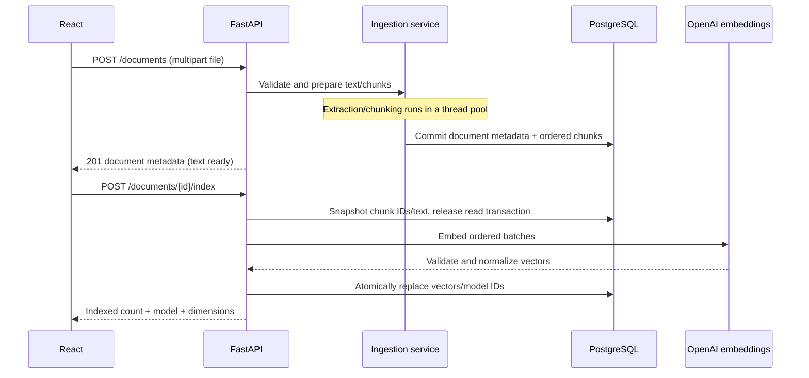
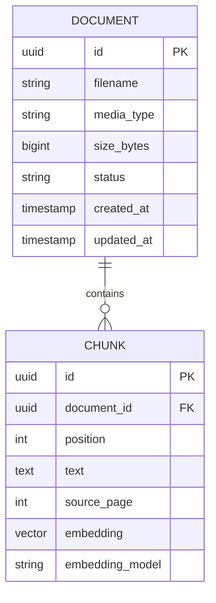

# Architecture and design decisions

DevDocs AI is a modular monolith with an independently built React frontend.
One FastAPI process coordinates persistence and OpenAI calls. This is appropriate
for a student portfolio and small collection: internal boundaries provide testing
seams without distributed-service deployment, tracing or message consistency.

## Ingestion and indexing



The two HTTP operations make indexing retryable without re-uploading. Failure in
any embedding batch leaves previously stored vectors intact; it cannot roll back
paid API calls. Text and pending vectors are held in application memory, so this
approach needs a durable queue and staged batches for much larger files.

Text/Markdown validation checks names, extension/content type, UTF-8 and content
limits. PDF validation also checks the PDF signature, encryption, pages and bounded
page streams. OCR is unsupported. Original binaries are not stored. PDFs are
chunked per page; character windows preserve indentation and repeated overlap,
but may split fenced code, definitions or sentences. Defaults are 1000 characters
and 150 overlap, not tokens.

## Question answering

```mermaid
sequenceDiagram
    participant UI as React
    participant API as FastAPI
    participant E as Embeddings
    participant DB as pgvector
    participant L as GPT-5.4 mini
    UI->>API: POST /questions (question + filters)
    API->>E: Embed question
    API->>DB: Exact cosine search with compatibility/scope filters
    DB-->>API: Bounded surplus of candidates
    Note over API: Remove duplicate/overlapping context; budget excerpts
    Note over API: Snapshot evidence and release read transaction
    alt No qualifying evidence
        API-->>UI: insufficient_evidence, no citations
    else Evidence exists
        API->>L: System instructions + untrusted source JSON
        L-->>API: Structured answer + labels
        Note over API: Validate labels/markers against supplied evidence
        API-->>UI: Generated text + separate cited excerpts
    end
```

`persistence/search.py` filters by ready document state, model identity, vector
size, optional document IDs/file type and similarity threshold before limiting.
A guarded cosine expression avoids comparing incompatible vector dimensions.
Exact search avoids approximate-index tuning at this scale; query cost grows with
compatible collection size. Consider an HNSW/IVFFlat index only after profiling,
with a deliberate strategy for the variable-dimensional column and recall trade-off.

`services/rag.py` over-retrieves three times top-k, removes duplicate text and
adjacent overlap, and caps supplied excerpt text at 5000 characters. Labels resolve
to stored UUIDs; the model cannot create those UUIDs. No evidence skips generation;
uncited output is discarded; unknown/mismatched labels are rejected. These controls
bound shape and provenance, not semantic truth or resistance to every prompt injection.

## Data model and interfaces



`source_page` is nullable and one-based; chunk `position` is zero-based.
The unique `(document_id, position)` constraint protects ordering. Check constraints
protect statuses, values and the embedding/model pair. The foreign key cascades
chunk deletion at the database level; a document deletion API is not implemented.
`updated_at` changes on ORM document updates, not chunk indexing or via a SQL trigger.

The vector column accepts different dimensions, while each query enforces its
configured model and dimensions. Same-sized vectors from different models can
have unrelated coordinates. Re-index all documents after changing embedding
providers, weights or dimensions. Mutable model alias changes are not detected.

`EmbeddingProvider`, `LLMProvider` and `ToolProvider` expose small typed contracts.
OpenAI is the only current adapter. A future replacement still needs implementation,
configuration, validation and evaluation; the protocols do not make another
vendor automatically available. A lifespan-owned HTTP client pools connections;
async HTTP calls release the event loop while waiting. Thread-pool PDF work does
not mean unlimited parallel CPU capacity or durable job processing.

## Optional assistant and deployment boundaries

[The agent](agent.md) permits one validated read-only tool request, then a final
cited generation for content. Metadata is returned directly. Scope belongs to the
user request; schema-valid model arguments cannot expand it. No multi-agent runtime,
recursive loop, arbitrary SQL, shell execution or autonomous background work exists.

Vite's development proxy and Nginx's container proxy strip `/api` before calling
FastAPI. The browser never receives provider keys. PostgreSQL and model providers
are external dependencies; `/health` checks the API process and `/ready` checks
DB connectivity, not migrations or provider health. Compose migrates before API
startup and retains database data in a named volume. All published ports bind to
loopback. [Production operations](production.md) explain images, errors and CI.

The shared collection has no per-user authorization. Request logs include route
templates, status, timing and correlation IDs, excluding questions, source text
and credentials. Safe errors trade raw tracebacks for privacy and reproducibility.
OpenAI indexing sends chunks to the provider, and questions send the question and
selected excerpts. `store: false` on Responses is not a promise of fully local
processing or an override of provider data policies.
