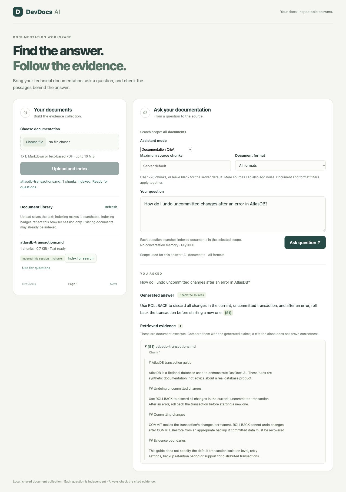
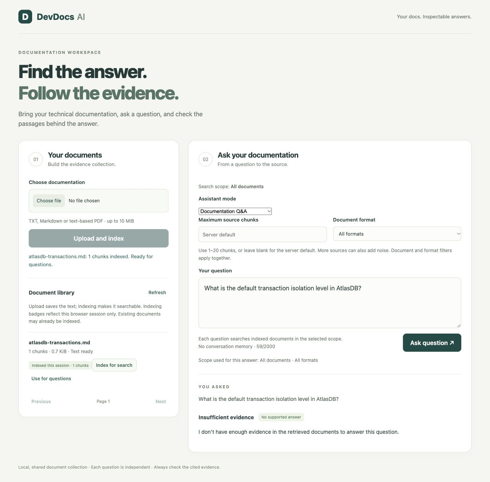
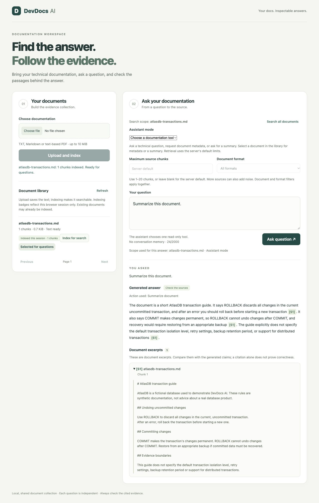

# Reproducible portfolio demo

These are actual screenshots of the application, captured on 10 October 2026.
They use `gpt-5.4-mini` generation and `text-embedding-3-small` embeddings with
[fictional AtlasDB documentation](../examples/atlasdb-transactions.md). No private
user documents or API keys appear in them. Responses can vary between runs;
these examples establish working flows, not an accuracy benchmark.

## Run a separate demo database

Keep your existing root `.env`, including the OpenAI key. From the repository root,
use unused ports and a separate Compose project so the demo does not modify your
normal document collection:

```bash
POSTGRES_PORT=15434 BACKEND_PORT=18001 FRONTEND_PORT=18081 \
POSTGRES_DB=devdocs_demo POSTGRES_PASSWORD=portfolio-test-only \
docker compose --project-name devdocs-portfolio-demo \
  up --build --detach --wait --wait-timeout 120
```

The password above is intentionally a disposable local demo value, not a secret
for a public deployment. Open http://127.0.0.1:18081. OpenAI operations use the
key in your ignored `.env` and incur provider usage charges.

## 1. Upload, index and inspect an answer

Choose `examples/atlasdb-transactions.md`, then **Upload and index**. Wait until
**1 chunks indexed. Ready for questions.** appears before asking a question.
Upload success alone is not indexing success; a question submitted while indexing
is still running can return insufficient evidence.

Ask **“How do I undo uncommitted changes after an error in AtlasDB?”**
Expand **Show source S1** and compare the generated answer to the source excerpt.
The answer should refer to ROLLBACK before COMMIT. Inspect the actual passage;
a citation marker alone does not establish that a statement is supported.



## 2. Ask beyond the available evidence

Ask **“What is the default transaction isolation level in AtlasDB?”**
The fixture deliberately does not specify this. The captured run returned
insufficient evidence rather than inventing an isolation level. A different run
should still be checked for unsupported claims; abstention is model-dependent
when relevant but incomplete context reaches generation.



## 3. Demonstrate a bounded agent tool

Select **Use for questions** on the document, choose **Choose a documentation tool**
in Assistant mode, then ask **“Summarize this document.”** Inspect the visible tool
trace and citation. The assistant chooses a read-only summary tool; this is a
bounded one-tool request rather than an autonomous multi-step workflow.



Metadata is another useful demonstration: ask **“Show the document metadata.”**
Its response contains database facts, while a summary contains generated prose.
See [the agent guide](agent.md) for scope and coverage limits.

## Cleanup

The screenshot session used this isolated project and its disposable database.
After your own demo, remove only that project and its volume:

```bash
POSTGRES_PORT=15434 BACKEND_PORT=18001 FRONTEND_PORT=18081 \
POSTGRES_DB=devdocs_demo POSTGRES_PASSWORD=portfolio-test-only \
docker compose --project-name devdocs-portfolio-demo down --volumes
```

Do not apply `--volumes` to your normal application project if you want to retain
its documents. Screenshots are committed artifacts; the disposable demo server
is not intended to stay running.
